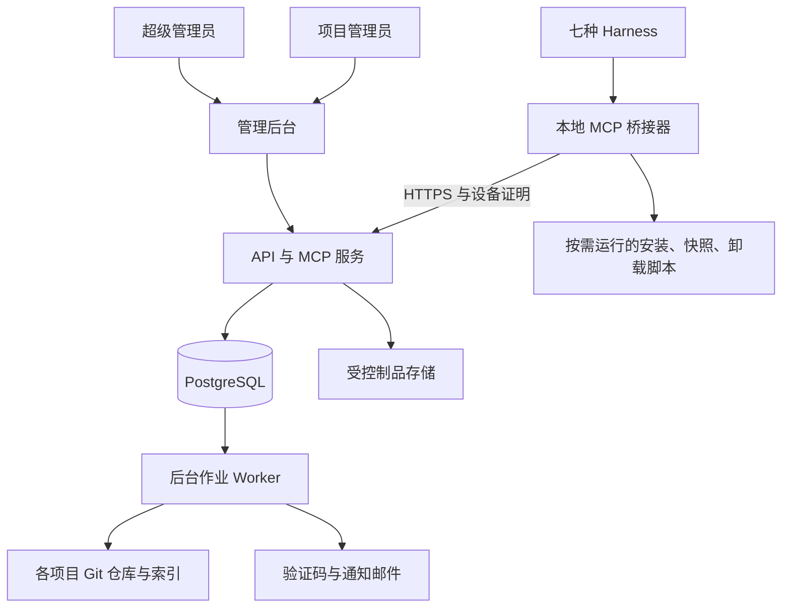

# 系统架构

> v0.1｜2026-11-05｜设计建议；约束以[设计总览](00_设计总览.md)中已确认需求为准。

## 1. 组件



首版用一个应用代码库实现管理 API、认证授权、MCP 和业务模块；Worker 可使用同一镜像的独立入口。PostgreSQL 作业表与事务事件承担首版异步任务，无需先引入消息中间件。

本地桥接器是 harness 启动的按需进程，向本机暴露 MCP，通过 HTTPS 访问中央服务。它保管设备凭证、封装上传接口，并把撤销结果交给 Agent。退出脚本由 Agent 调用，本地清理工具执行已登记流程。桥接器不承担任意远程 Shell 执行。

## 2. 权限矩阵

| 操作 | 超级管理员 | 项目管理员 | 普通成员 |
|---|---|---|---|
| 创建管理员、调整管理员资格 | 允许 | 无 | 无 |
| 创建项目、分配项目管理员 | 允许 | 无 | 无 |
| 查看全局人员与项目 | 允许 | 仅授权项目范围 | 仅获授权范围 |
| 邀请普通成员、调整开发/审查角色 | 允许 | 可申请或管理本项目；新增授权仍需审批 | 无 |
| 签发新授权、增加权限、批准设备 | 直接决定 | 发起申请，等待超管 | 可请求自己的登录或设备接入 |
| 移出成员、暂停项目资格 | 允许 | 仅本项目普通成员 | 无 |
| 调整其他项目或全局账号状态 | 允许 | 无 | 无 |
| 拆解、发布任务 | 允许 | 允许 | 获得 architect 能力后允许 |
| 认领、检查点、交接、提交 | 按执行协议 | 按执行协议 | 按角色与任务范围 |
| 合并、发布、管理 Git 权限 | 平台授权与 Git 权限分别配置 | 在项目策略授权范围 | 在项目策略授权范围 |

`project_admin` 是项目成员关系上的角色，`super_admin` 是平台角色。管理员资格不直接赋予任何项目访问权。普通成员角色调整造成权限增加时，先申请审批；减少权限可立即生效。项目管理员不能通过创建角色或代发 Token 扩大自身范围。

Git 分支保护、部署凭证和代码托管成员关系需要与平台权限配套。MCP 撤权事务先提交，Git 撤权作为重试作业执行，并显示未完成状态；不能把 MCP 撤权误报为所有外部 Git 通道均已撤销。

外部 Git 授权只在相应审批通过且成员资格有效后下发。Worker 在执行授权事件前重查当前状态，防止延迟的旧授权覆盖撤销。受控主分支要求合并校验，将提交 SHA 与平台已接收的 submission 绑定；单纯推送分支不等于获得任务交付或合并资格。

## 3. 账号与设备登录

### 3.1 账号创建

- 首个超级管理员通过服务器本地初始化命令建立，设置登录凭证并验证邮箱；无公共默认密码。
- 只有超级管理员能创建管理员账号。账号激活后设置自己的密码；项目管理员必须保持已验证邮箱。
- 项目管理员可邀请普通成员进入所管项目。账号建立、项目授权与 Token 签发是不同动作；首次授权未批准时不能访问项目。
- 普通成员可不绑定邮箱。选择绑定后必须完成验证，随后所有新设备都按邮箱验证规则处理。
- 账号登录建议使用用户名、密码及设备证明；邮箱是验证码通道和已验证属性，不作为可伪造的设备标识。

### 3.2 新设备流程

1. 本地桥接器生成设备密钥，提交公钥、系统和安装标签。
2. 用户通过浏览器完成本人登录，服务创建设备登记申请。
3. 账号绑定了邮箱：向已验证邮箱发送用途绑定的验证码；未绑定邮箱：跳过邮件步骤。
4. 所有新设备都等待超级管理员审批；审批页展示申请者、设备公钥指纹和申请范围。
5. 两项条件都满足后，设备标记为 `approved`；项目访问还需已有的已批准授权。
6. 桥接器领取设备绑定的会话凭证，harness 使用桥接器调用项目服务。

浏览器回调采用经过登记的 loopback 地址、随机 state 和 PKCE，绑定同一登录请求与设备公钥；只在验证和审批完成后发放项目会话。平台不收集各 harness 自身的模型供应商登录凭证。

“设备”在首版中指已登记的设备密钥安装实例。IP、主机名或 MAC 地址不能代替密钥证明。复制 Token 后仍须证明持有绑定私钥；软件私钥被完整复制或终端被控制时，不承诺识别物理机器克隆。

建议用标准 DPoP 约束访问和刷新凭证，使用系统凭证存储保护密钥与恢复凭证。DPoP 不是邮箱验证或人员审批的替代品。原生远程 MCP 直连只有在通过同等设备绑定验收时才可启用，不能提供无设备证明的静态 Token 旁路。

### 3.3 三种凭证

| 凭证 | 权限来源 | 生命周期 |
|---|---|---|
| 授权记录 / grant | 超管批准精确的用户、项目、设备、角色和能力 | 撤销、过期或权限变化后重新核验 |
| 访问与刷新会话凭证 | 当前有效 grant；短期凭证由系统自动生成 | 可自动续期，续期不扩大权限，并检查当前所有状态 |
| 退出恢复凭证 | 初次授权时同时批准的有限收尾能力 | 撤权后仅用于该设备、该部署的状态、上传和清理回报 |

管理员的“签发”动作是提交申请，超管审批后中央服务执行生成；签名密钥只在服务器。审批对象发生变化则旧审批失效，禁止批准 A 后签发 B。

短期访问令牌的签名有效不等于当前仍有权限。每次正常请求查询当前账号、设备、成员关系和 grant；首版不使用可能掩盖撤销的正向权限缓存。刷新令牌轮换、仅存摘要，检测旧令牌复用后撤销该会话族。

超管的新设备也需要邮箱验证和审批。可由现有可信超管会话完成审批；全部可信设备丢失时使用服务器本地恢复流程和预先保存的恢复码，记录审计并通知邮箱。

## 4. 项目隔离

每次操作先从可信凭证确定调用者，再检查对象实际归属。请求中的 `project_id` 只是目标，不能赋予访问权限。

隔离覆盖文档、正文片段、任务、消息、日志、制品、下载链接、搜索计数和导出。先限制到授权项目再检索和排序。未授权对象返回统一的不可访问结果，不泄露其他项目名称或成员。

数据库使用服务层检查与 PostgreSQL RLS 双重限制。应用运行账号不拥有业务表、不使用数据库超级用户或 `BYPASSRLS`。每个事务设置经过验证的调用者上下文，连接复用时不遗留上一用户状态。平台超管身份来自数据库中的真实账号记录，不能来自客户端传入的 `is_admin`。

Worker 按单个事件的项目运行，使用独立权限和固定任务入口；备份、迁移和平台管理角色不暴露给 MCP。

## 5. 文档、Git 与数据库

推荐每个项目自己的私有仓库包含代码与 `Agent文档/`。框架发行仓库包含通用 Skill、模板、脚本和协议，不包含各项目私有材料。已有独立代码仓库也可以登记为同一项目的多个仓库，Git 权限需一起管理。

```text
框架发行仓库/
  skills/                 通用安装与协作工作流
  templates/              通用模板
  client/                 桥接器和跨平台脚本
项目私有仓库/
  src/
  Agent文档/
    main.md               当前项目入口
    知识库/
    经验库/
    决策/
    任务/                 任务说明与生成的状态快照
  .agent-framework/       本项目已部署的框架产物
```

旧的项目前缀目录可在导入时保留，数据库映射到稳定 `project_id`。全局项目清单只在超管后台展示，普通项目入口只列出当前项目。

索引保存文档 ID、仓库、相对路径、提交 SHA、内容哈希、标题、标签和检索正文。读取返回可核对的版本。并发编辑通过基于内容哈希的条件提交形成变更提案，再进入 Git 合并流程。

首版搜索采用结构化过滤、关键字和 PostgreSQL 文本索引；可用 `pg_trgm` 加速适合的字符串匹配。中文短词需要专门回退与基准验证，不把默认英语分词当作完整中文检索。向量检索是后续增强，不是首版必需组件。

## 6. Docker 与持久化

| 服务 | 首版职责 | 持久化 |
|---|---|---|
| HTTPS 入口 | TLS、反向代理、请求大小限制 | 证书与受控配置 |
| app | 管理 API、登录、MCP、权限和业务事务 | 通过数据库和存储保存 |
| worker | 邮件、Git 同步、索引、外部撤权、备份作业 | PostgreSQL 作业与事件 |
| postgres | 关系型主库 | 独立数据卷 |
| artifact storage | 工作快照、上传分块、接收回执 | 宿主持久化目录，后续可换对象存储 |

仅 HTTPS 入口对外公开；PostgreSQL 使用内部网络。镜像和数据库稳定版本在实施时固定，并记录升级和回滚步骤。设计不依赖某个“最新”标签。

建议服务器布局：`/srv/agent-hub/` 下分别设置 `repos/`、`artifacts/`、`config/` 和受控备份目录；数据库使用专属数据卷。Git 工作副本和制品不能仅存于容器可写层。

备份覆盖数据库、Git 仓库、制品和必要加密密钥；索引可重建，授权及退出状态必须恢复。上线前验证一次完整恢复，备份副本应放在与主机故障边界分离的位置。

## 7. 外部依据

以下资料用于技术选型和协议边界，不代表已经完成产品适配：

- [PostgreSQL 行安全策略](https://www.postgresql.org/docs/current/ddl-rowsecurity.html)：支持行级策略；运行角色需避免所有者和超级用户绕过。
- [PostgreSQL 显式锁](https://www.postgresql.org/docs/current/explicit-locking.html)：提供并发协调所需的行锁等能力。
- [SQLite 适用场景](https://www.sqlite.org/whentouse.html)：SQLite 可服务许多应用，本设计因集中授权和并发事务选择服务器数据库。
- [MCP 授权规范](https://modelcontextprotocol.io/specification/2026-07-28/basic/authorization)：HTTP MCP 的标准授权与发现边界；客户端版本仍需协商和验收。
- [RFC 9449：DPoP](https://www.rfc-editor.org/info/rfc9449/)：将凭证约束到持有对应密钥的发送方。
- [PostgreSQL pg_trgm](https://www.postgresql.org/docs/current/pgtrgm.html)：字符串相似和部分匹配索引能力；实际中文效果需测量。
- [官方 Python MCP SDK](https://github.com/modelcontextprotocol/python-sdk)：建议的协议实现基础，依赖版本在实施时锁定。
