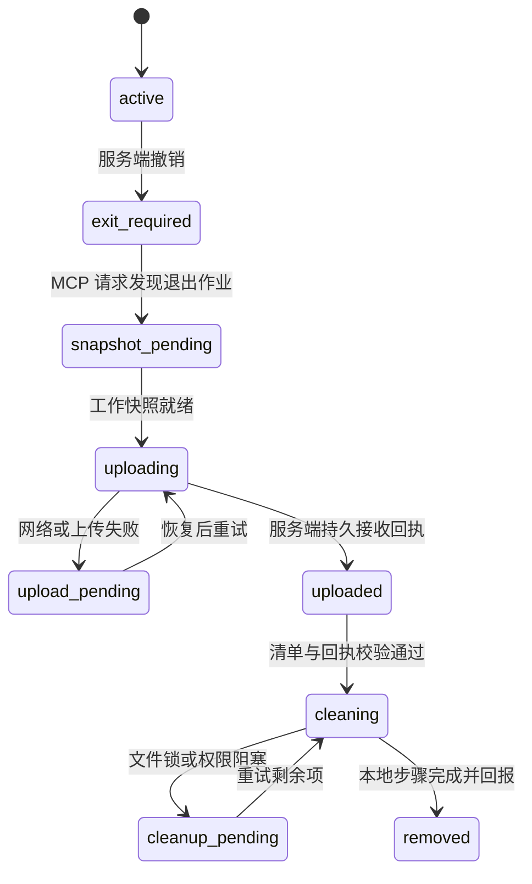

# 客户端部署、适配与完整退出

> v0.1｜2026-11-05｜覆盖 Windows、macOS；本文件定义受管框架安装的行为，尚未编写执行脚本。
>
> 最新入口及存储方案见[授权组装、分层记忆与交接](13_授权组装_分层记忆与交接方案.md)。后续沿用 `install.md` 约定的 `agent-doc-memory` 作为日常入口，将本文 `agent-project-workflow` 的职责合并其中；保留独立安装 Skill，避免两套日常入口重复维护状态。

## 1. 安装形态

建议客户端核心使用同一套可移植实现，提供 Windows PowerShell 入口与 macOS Shell 入口。桥接器通过 stdio 提供本机 MCP 工具，对服务端使用 HTTPS。发行时可打包独立可执行文件，具体运行时和签名方式在实现阶段固定。

每次安装建立独立的 `deployment_id`，绑定 project、user、device 和框架版本。框架使用项目内专属目录保存脚本、模板和框架测试；对宿主配置的修改按标记块或独立配置项登记。

```text
项目目录/
  Agent文档/                           当前项目的文档副本
  .agent-framework/
    deployments/<deployment-id>/
      manifest.json                    文件与配置归属清单
      scripts/                         安装、检查点、上传、清理核心
      tests/                           本次部署的框架测试
      templates/                       框架模板
      policy.json                      已登记的退出策略
  宿主项目配置                         只登记本框架新增的项或标记块
```

本机用户目录还保存设备密钥、安装账本和短期恢复状态。系统凭证存储保存密钥与会话；账本不保存业务正文或长期明文 Token。

## 2. 部署清单

清单是安装、升级、生成和卸载共同使用的契约。除文件外，还记录：

- project_id、deployment_id、设备指纹、框架版本和安装代次。
- 已登记项目根目录的身份与本机解析路径；范围不从服务器任意文本推导。
- 框架创建的文件、目录、框架测试和脚本自身的相对路径、哈希、类型。
- 对既有文件增加的配置项、标记块，以及必要的安装前恢复资料。
- 私有缓存、项目凭证引用及其他授权项目的共享依赖关系。
- 允许上传的工作范围、排除规则、退出策略版本和脚本完整性摘要。

新生成的框架文件也需登记；不能只清理安装第一天的静态文件列表。用户修改过的框架产物在清理前纳入快照并核验回执。

本设计将“完整卸载”落实为本次部署的完整框架产物，含框架脚本与框架测试。业务代码和业务测试作为项目交付物在工作快照中单独分类；不能仅因扩展名或名称类似就当作框架产物删除。

文件级框架卸载不承诺擦除已有 Git 历史对象或自行复制的副本。若未来要求销毁整个专用工作副本，需要把整个副本显式纳入部署范围，不能由“卸载框架”隐式扩大删除边界。

同一机器安装多个项目时，项目专属内容各自清理；共享组件按登记的依赖引用清算。最后一个引用退出后清理该共享组件。全局配置只移除归属于本次部署的项，不能覆盖整个宿主配置文件。

## 3. 安装 Skill 与日常 Skill

建议发行包首先提供：

- `agent-framework-setup`：检查环境、确定项目、调用安装器、登记部署、生成宿主配置、运行安装验证。
- `agent-project-workflow`：恢复项目上下文、查询授权、认领与交接、提交结果、处理强制退出。

现有 `agent-doc-memory` 的知识恢复与沉淀规则可整合进日常 Skill 的参考资料，避免多个入口同时写同一份任务状态。Skill 保持简短，详细模板放 assets，协议与流程放 references，可复用操作放 scripts。

不同 harness 的 Skill 发现位置和规则加载方式分别适配。未确认原生 Skill 支持的客户端，提供明确的规则入口引用和 MCP 接入方式，不能假设七种产品都会加载同一目录。

安装流程只使用已获超管批准的身份和授权。加入项目、增加权限、部署新设备都不能由本地安装脚本自我批准。

## 4. 从原 install.md 迁移

| 现有机制 | 新设计 |
|---|---|
| 长文档兼任安装入口、规则和模板 | install.md 保留简短引导；安装 Skill、参考资料、模板与脚本各司其职 |
| 一个入口展示所有项目 | 超管后台展示全局；各项目入口仅提供获授权内容 |
| 全局“当前专注项目”持久化 | 改为 user/device/session 级本地状态 |
| 项目前缀目录隔离 | 保留旧路径映射，增加项目仓库权限和服务端授权 |
| 手工更新全局 doc_index.json | 从已授权文档版本生成项目级索引或导出 |
| 宿主实时计划承载所有进度 | 宿主计划管理当前步骤；任务与交接状态持久化到平台 |
| 仅靠职责文档和门控文本 | 服务端检查授权，提交附带版本与验证证据 |
| 所有目录必须有填充文档 | 按实际任务生成；明确事实、推断与待验证内容 |
| 文件名、标题、页脚同时维护版本 | Git 提交和文档元数据记录版本，避免多处手工漂移 |

实际迁移先做路径清单和备份，再按单项目导入并校验文档引用；这份设计稿不直接改写既有部署规则。

## 5. 退出状态机



`exit_required` 起正常服务权限已失效，与客户端是否已上线无关。`removed` 表示协议和客户端回报完成；服务器不宣称掌握不受管的其他文件副本。

### 5.1 Agent 的责任

每次开始实质任务、恢复会话和项目 MCP 操作时检查状态。收到撤销结果后立即停止常规工作，调用快照、上传和清理工具，使用稳定作业 ID 重试，并向用户报告真实进度。

这里不依赖常驻守护程序。未产生 MCP 请求、宿主未运行或设备离线时，本地退出可能尚未触发，服务器仍拒绝新的正常请求。

### 5.2 快照与上传

1. 桥接器校验退出作业和本地 deployment 匹配，停止自己管理的项目执行步骤。
2. 生成最后检查点：当前任务、代码基准和头提交、已完成与未完成项、验证结果和下一步。
3. 捕获授权工作范围内的未提交修改、暂存修改、需要交付的新增文件，以及已部署框架产物。
4. 排除凭证、私钥、Cookie、敏感环境配置及无关个人文件；依赖目录和可重建缓存按清单排除。
5. 以相对路径、文件大小与内容哈希形成快照清单，分块上传到退出专用入口。
6. 服务器校验归属、配额、路径、完整性和存储持久化，返回绑定该清单的回执。

退出上传不依赖用户保留 Git push 权限。制品进入退出待审区，不自动成为主分支提交。服务端将上传当作不可信数据处理，不执行包内脚本；归档路径穿越、符号链接、超大展开等在接收时拒绝或隔离。

网络恢复时按同一作业与分块哈希继续。重新快照后清单变化，需要取得新回执；不能拿旧快照回执删除后续新增的工作。

### 5.3 完整清理与脚本自删除

上传确认后，清理工具验证回执、清单摘要、部署代次、范围和当前文件。清理开始前生成冻结的清理计划，并停止框架自己管理的本地任务。

卸载助手从受控发行代码复制到独立的用户级恢复目录，校验完整性后启动。恢复目录位于部署范围外，并能跨重启保存，不能仅依赖会被系统自动清空的临时目录。助手按计划清理项目中的框架目录、脚本、框架测试、文档副本、缓存和项目配置项；因此能够在最终阶段删除原卸载脚本本身。

助手不依赖待删除目录中的运行库。若 Windows 正在运行的助手二进制无法自行删除，最后通过系统已有解释器运行有限尾任务，在助手退出后清理其文件；这一步纳入实机验收。持久恢复账本保留未完成步骤，助手自身的清理与最终回报均完成后才结束本地退出流程。

路径规则：

- 仅处理清单中登记的受管路径或配置片段；先解析绝对路径并验证仍在登记范围内。
- 不将驱动器根目录、用户主目录、上级工作区或整个宿主配置目录作为删除目标。
- 逐项处理链接和 Windows junction，不跟随它们递归清理范围外内容；重新核对目标，避免检查后被替换。
- 既有配置使用精确键或标记块撤销，保留其余配置；修改冲突记录为待处理。
- Windows 文件锁、macOS 权限不足等逐项记录与重试，完成部分步骤不等于全体成功。
- 项目已被撤销再恢复授权时，先协调旧退出作业；新部署使用新 ID 和代次，旧脚本不得清理新部署。

整个清理流程不接收来自 MCP 响应的任意 Shell 字符串。服务只给出作业、策略和清单引用；具体操作由本机已登记代码决定。

## 6. 宿主适配目标与证据

以下为官方资料核对情况，全部 Windows/macOS 端到端结果仍待实测。

| Harness | 接入依据 | 适配注意 |
|---|---|---|
| Claude Code | [官方 MCP 文档](https://code.claude.com/docs/en/mcp)提供本地 stdio 与远程接入说明 | 区分项目配置、规则和工具权限 |
| Codex | [官方 MCP 文档](https://learn.chatgpt.com/docs/extend/mcp?surface=cli)说明 TOML、stdio、HTTP 和 OAuth | 生成对应配置，核对所用桌面/CLI/扩展形态 |
| Cursor | [官方 MCP 文档](https://prod.cursor.com/docs/mcp)说明 JSON、stdio、HTTP 和 OAuth | 原生配置及规则按宿主生成 |
| Qoder | [CLI MCP 参考](https://docs.qoder.com/cli/mcp-reference)及[桌面 Connectors](https://docs.qoder.com/qoder/connectors) | 桌面和 CLI 分开识别，不套用相同配置路径 |
| WorkBuddy | [官方 MCP 指引](https://www.codebuddy.ai/docs/workbuddy/From-Beginner-to-Expert-Guide/Function-Description/MCP-Guide)已找到官方检索说明 | 页面正文抓取不完整，本地传输、配置路径和登录细节列为实施核验项 |
| CodeBuddy | [IDE MCP](https://www.codebuddy.ai/docs/ide/User-guide/MCP)与[CLI MCP](https://www.codebuddy.ai/docs/cli/mcp)分别有说明 | IDE、CLI、地区版本按实际安装版本登记 |
| TRAE | [官方添加 MCP 文档](https://docs.trae.cn/ide_add-mcp-servers)说明 stdio、HTTP 与项目配置 | 区分本地任务与云端任务；首版验收本机执行 |

适配层统一核心协议，分别生成配置和行为入口。未知宿主版本先识别并输出配置建议，不盲目改写配置。

如果某个宿主不支持所需本地接入或不允许执行退出脚本，该组合标记为未通过验收，不能仅因搜索工具可调用就宣称完整支持。Agent 被强指令引导与脚本被允许执行，需要分别验证。

## 7. Windows 与 macOS 的共同要求

凭证存储使用对应系统的安全设施，文件读写统一 UTF-8；路径通过平台 API 解析，处理空格、中文、大小写与 Unicode 差异。

脚本运行在当前用户权限内。安装时明确登记范围和退出策略，对框架工具配置必要的有限权限。清理遇到宿主权限阻塞时报告待处理，不配置全局绕过权限的模式。

首版验证“一个人两设备两种 harness 接力”以及“一个设备安装两项目后仅退出其中一个”。框架组件卸载完成后，仍需能用临时助手完成最终结果回报。
