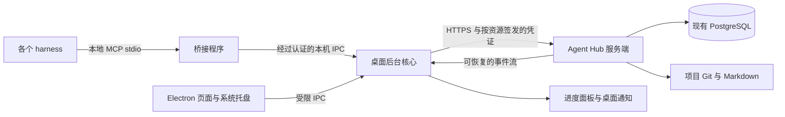

# 桌面端与 MCP 桥接

> 2026-11-06 Windows `0.3.1` 提供会话版本检测与自动更新。文档查询、项目授权与其他现有能力继续通过本机 MCP 提供。

## 0. 当前交付与待办

使用说明见 [agent-hub-desktop](../projects/agent-hub-desktop/README.md)，验证证据见[实施记录](06_实施记录.md)。

| 功能 | 当前状态 |
|---|---|
| 账号登录、邮箱验证码、设备审批检查 | 已实现，沿用内部 REST 签名协议；OAuth/PKCE 待实现 |
| 多项目目录绑定、独立项目会话 | 已实现，服务器逐请求鉴权 |
| stdio MCP | 已实现 `2025-11-25` 及列出的早期握手版本；项目读取、进度查询/上报及文档索引/搜索/读取 |
| harness 配置 | 通用配置复制与 Claude Code `.mcp.json` 预览、备份、冲突校验；商业 harness 实测待完成 |
| 进度面板、流重连和通知 | 已实现持久报告、SSE、游标去重、托盘通知接线；通知事件联调通过，系统展示受用户通知权限影响 |
| 撤权 | 已实现受管 MCP 拦截与界面状态；收尾上传、回执与卸载待实现 |
| 文档、任务、Git 自动同步 | GitHub Markdown 索引及查询已完成，需管理员触发同步；任务认领和 Git 自动同步待实现 |
| 发行 | Windows x64 便携包支持签名更新、自动重启和启动失败回退。Windows 应用代码签名、macOS 与其他 harness 的原生适配待完成 |

服务端使用原有服务器 PostgreSQL，版本 `0.3.0`、正式迁移 `0005`。本轮本机 23 项测试、服务器 53 项测试、实际浏览器/Electron 与打包产物检查通过。两套设备身份的联调在同一 Windows 工作站上进行，尚不能替代多物理设备和跨系统验收。文档功能见[Git 文档索引](11_Git文档索引与MCP查询.md)，历史修复见[首版复查与待办](10_首版复查与待办.md)。

## 1. 目标与职责

桌面端为 Windows/macOS 用户提供统一登录、项目选择、本机 harness 接入、任务动态与通知，以及框架安装和退出执行入口。服务器继续保存权威身份、审批、项目授权、任务、文档索引、审计及上传回执；Git 保存版本化 Markdown 与代码。

这里的“登录后获得 MCP”指桌面端启动本机桥接，并将选定项目的接入配置交给 harness。服务端凭证由后台核心保管，harness 配置保存本机桥接命令和受限绑定标识。桌面端不获取数据库账号，也不自行签发服务端项目权限。

桌面窗口关闭后可以由托盘保持桥接服务运行；完全退出后，harness 应清楚显示客户端离线并停止受管远程操作。服务端、桌面核心和 MCP 桥接器分别定义生命周期与健康状态。

## 2. 登录、设备与权限

1. 桌面端生成并保管本设备身份，向服务器申请登录。
2. 绑定邮箱的新设备必须通过真实邮件验证；所有新设备仍需超级管理员审批。
3. 超管创建管理员和项目。项目管理员可以管理获授权项目、申请签发，审批仍由超管完成。
4. 桌面端只展示当前设备已获批准的项目、能力和期限；首次授权、增加权限及新设备继续要求审批，已有批准会话可按既有规则续期。
5. 每个 harness 连接绑定明确的服务端、账号、设备、项目、工作目录与能力范围。切换桌面界面的项目，不改变已经运行连接的绑定。
6. 同一项目在多设备或多个 harness 中可以同时连接；具体任务认领由服务器原子操作决定，保留租约、代次与幂等规则。

正式桌面登录采用系统浏览器授权码加 PKCE，回调绑定当前登录事务和随机 state。桌面应用是公共客户端，安装包不保存可充当身份的客户端密钥。当前内部 REST 登录不是已完成的 OAuth 授权服务器，标准认证组件仍需补齐。[原生应用登录规范](https://www.rfc-editor.org/rfc/rfc8252.html)

桌面端调用内部 API 与远程 MCP 时使用各自目标资源的授权凭证；本机凭证不能直接当作远程 API Token 使用。服务器对每次受管调用和续期重查账号、设备、成员、项目授权和到期状态。[MCP 授权规范](https://modelcontextprotocol.io/specification/2026-07-28/basic/authorization)

## 3. 本机 MCP 接入

- 首期已提供独立的小型桥接程序，harness 通过标准 stdio 启动它。Windows 使用随机命名管道与桌面核心通信，校验独立连接秘密和固定项目绑定，描述文件保存在当前用户应用目录。Unix socket 分支已编码，macOS 实测与系统对端身份校验仍待完成。
- 后续可增加只监听 loopback 的 Streamable HTTP 入口。必须校验 Host、Origin 与客户端凭证，不能将本机 MCP 监听在所有网卡。
- 本机连接凭证仅用于桥接鉴权，按账号、项目和客户端绑定，能够单独撤销。服务端访问凭证、刷新凭证和设备私钥不进入 harness 配置文件、模型上下文或日志。
- 桥接器对 stdout 只输出协议消息，日志走 stderr。实现时记录采用的协议版本，并针对目标 harness 实测兼容性。
- 第一阶段选择一个实际使用的 harness 跑通，再扩展到其余客户端；七种 harness 的 Windows/macOS 支持仍按原验收矩阵逐项记录，不能从统一桥接设计推定全部兼容。

参考：[MCP 传输规范](https://modelcontextprotocol.io/specification/2026-07-28/basic/transports)、[官方仓库的本地服务安全说明](https://github.com/modelcontextprotocol/modelcontextprotocol/blob/main/docs/docs/2026-07-28/tutorials/security/local-server-security.mdx)。

## 4. 功能优先级

| 优先级 | 功能 | 用户得到什么 |
|---|---|---|
| 首期 | 登录、邮箱验证、设备与权限状态 | 清楚知道当前账号、设备和项目能做什么 |
| 首期 | 项目工作区绑定与 MCP 连接检测 | 选择本地目录，检测连接、配置冲突和授权状态 |
| 首期 | harness 配置向导 | 预览配置差异、备份已有配置、写入有归属的项并验证 |
| 首期 | 消息中心与托盘通知 | 授权审批、任务分配、完成、阻塞、撤权等动态可查看 |
| 后续 | 任务指挥台 | 查看认领人、设备、harness、租约与最近检查点 |
| 后续 | 跨设备交接 | 保存任务、分支、提交 SHA、未提交快照和下一步说明 |
| 后续 | 文档与决策变更提醒 | 查看 Markdown 差异、对应提交和受影响任务 |
| 后续 | 退出作业面板 | 查看冻结、快照、上传、回执、卸载及失败重试状态 |
| 后续 | 审批收件箱 | 超管处理设备和授权申请，项目管理员处理范围内事务 |
| 后续 | 网络和接入诊断 | 查看服务可达性、凭证期限、桥接状态和可脱敏导出的日志 |
| 已实现 | 客户端更新与版本清单 | 桌面启动和项目对话检查版本，校验签名后切换，启动失败时恢复旧版 |

首期保持这些边界：代码编辑继续由用户选择的 harness 完成；全局状态存服务器；桌面端缓存界面、已接收进度和连接状态。当前没有离线待发送队列，不需要额外部署数据库，也不需要在用户设备安装 PostgreSQL。

## 5. 进度与通知

项目进度来自 harness 上报的任务状态、检查点、测试结果、提交和 Git 事件。桌面端展示这些证据及更新时间，区分“已完成”“执行中”“阻塞”“离线”“等待审查”；完成比例需要明确任务权重和完成定义。

服务端在事务中提交状态及事件，再通过可恢复的 SSE 或 WebSocket 事件通道推送给桌面端。这条应用通知通道独立于 MCP 的传输连接。事件包含事件 ID、项目 ID、任务与尝试 ID、执行代次、服务器时间、状态及必要的提交引用。

断线重连带上事件游标；客户端按 ID 去重，发现保留期之外的缺口时重新拉取快照。事件过滤和详情查询均由服务器根据当前授权执行，推送不能泄漏其他项目的名称或内容。静音、聚合提醒和锁屏摘要属于用户个人设置；撤权状态仍必须及时显示。

## 6. 上传与撤权退出

桌面端为“脚本执行、结果检查和恢复”提供稳定宿主，agent 接收服务端指令并协助收尾。收到撤权事件或普通调用被拒绝后：

1. 冻结对应项目的常规远程操作，标记本机退出作业。
2. 使用绑定设备、项目与部署代次的受限收尾能力生成清单、快照并上传。
3. 断网或上传失败时保存待办与快照，恢复后幂等续传；持久回执确认覆盖本次最终工作后再进入清理。
4. 清理该项目部署清单中的完整框架：规则、文档、Skill、脚本、框架测试、配置归属项及卸载脚本自身。逐项校验实际路径、链接及部署代次。
5. 保留其他项目的部署、用户自有配置及多项目桌面入口，展示剩余待清理项和最终回执。

退出某一项目和停用整个账号是不同作用范围。账号停用影响全部普通远程权限，已有收尾作业仍按专用受限身份处理。当前后端尚未实现这些收尾和卸载能力，此处不代表已具备自动删除功能。

## 7. Electron 实现边界

- 界面使用随客户端发布的本地资源；启用 renderer 沙箱与 contextIsolation，关闭 renderer 的 Node 集成；preload 只暴露经过参数校验的窄接口，后台核心验证 IPC 来源。[Electron 安全建议](https://www.electronjs.org/docs/latest/tutorial/security)
- 持久凭证由主进程使用操作系统提供的保护保存，结合设备签名与服务端撤销。macOS 使用 Keychain，Windows 使用 DPAPI；这不能被当作对同一操作系统用户下所有进程的绝对隔离。[Electron safeStorage](https://www.electronjs.org/docs/latest/api/safe-storage)
- 本地工作区必须由用户明确绑定，框架安装和清理由版本化部署清单追踪；不扫描或上传其他目录。配置修改保留原始备份、归属和可回滚差异。
- 更新包校验签名与版本，Windows/macOS 的应用签名、安装和系统权限分别实测。

## 8. 建议实施顺序与验收

1. 服务器 IP HTTPS、已有可信设备入口和 Windows 桌面首版已完成；补标准认证组件和一个实际 harness 的完整接入。
2. 接版本化 Markdown/Git、文档索引和受限 MCP 文档查询。
3. 接任务原子认领与交接，复用现有进度事件，演练两台物理设备竞争及跨系统接力。
4. 接上传回执、完整框架退出与断网恢复，再扩展 macOS 和其余 harness。

| 验收场景 | 必须看到的实际结果 |
|---|---|
| 已登录但没有项目授权 | 看不到未授权项目内容，桥接调用被拒绝 |
| 同人同时打开两个项目 | 各连接绑定不随界面切换，文档和任务不会串项目 |
| 多设备竞争同一任务 | 仅一个主执行者成功，旧代次提交被拒绝 |
| 重复或丢失通知 | 重连补齐、去重，最终状态与服务器一致 |
| 撤权与界面窗口关闭 | 托盘核心仍处理事件；普通调用由服务器拒绝 |
| 收尾期间断网 | 工作保留、恢复续传，回执就绪前不提前清理 |
| 一个项目退出 | 该项目完整受管框架被处理，其他项目仍可使用 |
| 完全退出客户端 | 桥接清楚报告不可用，不扩大离线权限 |
