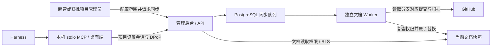

# Git 文档索引与 MCP 查询

> 2026-11-06｜服务端 0.3.0，迁移 0005；Windows 桌面端 0.2.0。

## 1. 当前实现

GitHub 仓库中的 Markdown 是原件。PostgreSQL 保存可重建的当前快照；桌面端通过已绑定项目的设备会话查询，每次重新检查权限。首版采用文字片段匹配，支持中文；没有语义向量检索、写回 Git、自动推送同步或文档提案合并。

当前适配 `github.com` 的 HTTPS 仓库地址。使用 GitHub REST 获取分支对应的完整提交号，再读取该提交的 ZIP 归档。服务端不执行 Git checkout、仓库脚本、子模块或自定义协议。未安装额外数据库，也不需要设备上的数据库。

## 2. 第一个真实项目：kms

用户提供：`https://github.com/yzw641725631-boop/kms.git`，并确认它是私有仓库。服务器匿名请求返回 404；尚未读取该仓库内容，默认分支和实际文档范围待凭证配置后确认。

1. 超管在已有后台的“项目管理”中建立 `kms` 项目；项目名称、标识可均使用 `kms`。
2. 选择该项目，打开“项目文档”，填写上述仓库地址。
3. 分支填写仓库的实际分支。页面的 `main` 是默认输入值，未验证它就是该私有仓库的默认分支。
4. 路径每行一项，例如 `docs`、`AGENTS.md`、`install.md`；仅填写实际需要共享的目录或文件。原框架目录里的 `设计文档` 不会自动成为 kms 的文档。
5. 在后台填写只授权该仓库的 GitHub 只读凭证，保存，再点击“同步文档”。凭证不要发到聊天或放进 Markdown。
6. 点击“刷新状态”，核对成功状态、提交号和文档篇数。索引为零篇时需检查路径及 Markdown 扩展名。
7. 超管为成员设备批准 `project:read`、`documents:read`。项目管理员管理文档源还需审批 `documents:manage`；角色分配本身不会增加设备权限。
8. 升级桌面端、更新 MCP 配置并重新加载工具。先搜索，再用结果中的路径和 `snapshot_id` 读取。

GitHub fine-grained PAT 为所选仓库授予 `Contents: read` 即可满足相关读取接口，参见 [GitHub 仓库内容与归档接口](https://docs.github.com/en/rest/repos/contents#download-a-repository-archive-zip)。不需要授予 Hub 使用者个人 GitHub Token。

目前正式项目仍需由超管登录创建，没有通过迁移脚本、测试账号或绕过设备审批来创建 kms。

## 3. 权限与密钥

| 主体 | 能力 |
|---|---|
| 超级管理员 | 所有项目的配置、同步和读取 |
| 项目管理员 | 仅获批项目，且配置/同步需 `documents:manage` |
| 普通成员 | 仅获批项目，查询和读取需 `documents:read` |
| `hub_runtime` 数据库角色 | API 权限；不能插入文档正文，不属于索引角色 |
| `hub_document_worker` | 独立登录角色，继承 NOLOGIN 的 `hub_indexer`；有索引所需的明确表权限 |

新表 `document_repositories`、`document_syncs`、`project_documents` 均启用并强制 RLS。无身份上下文无法查询项目索引；只有 `project:read` 也不能读正文。索引角色可处理全部项目的文档作业，因此其数据库密码仅在服务器的受控环境文件中保存。

仓库凭证用专用 HKDF 派生密钥及 Fernet 加密后存入 PostgreSQL；与 SMTP 使用不同的派生域。后台只返回“已有凭证”的状态，桌面端、MCP、审计及幂等结果不返回明文凭证。备份恢复需要同时恢复受控的 `HUB_SECRET`。GitHub 凭证不等同于 Hub 项目授权；Hub 撤权不自动移除用户在 GitHub 已有的独立权限。

## 4. 同步一致性与范围

- 同一项目只有一个排队或运行中的任务。相同幂等请求返回同一作业；Worker 支持五分钟租约、最多三次领取以及领取代次校验。
- 只有领取和发布使用短数据库事务；GitHub 网络请求发生在事务外，不持有身份协调锁。
- 发布前复查发起者账号、设备、成员身份、当前授权和配置版本。撤权或配置变化使旧作业取消；旧 Worker 不能覆盖新的领取结果。
- 同配置下同步失败保留上次成功的全部索引。成功发布一次性替换文档和提交引用，删除仓库已移除的文件。
- 修改配置会立即清除旧索引并取消旧作业，避免继续展示原仓库或原范围的内容。读取和翻页可绑定 `snapshot_id`；快照变化返回明确冲突。
- 只允许明确的相对目录或文件，不接受仓库根目录、`..`、绝对路径和反斜杠。不把 ZIP 解压到文件系统。
- 只处理选中范围内的 `.md` / `.markdown`，要求 UTF-8；跳过符号链接、已知凭证目录以及路径中带“明文”的文件。路径约束不能识别任意正文中的秘密，管理员仍需选择合适的共享范围。
- 最大归档 32 MiB、50,000 个条目；最多 1000 篇，单篇 256 KiB、总正文 8 MiB。超限失败保留原快照，界面给出错误；大代码仓库建议使用独立文档仓库。
- GitHub 网络仅访问固定 API 与 codeload 域名，验证 HTTPS，不将 Authorization 转发给归档重定向地址；不公开 provider 的错误正文或带签名的下载 URL。

## 5. API 与 MCP

| 接口 | 说明 |
|---|---|
| `GET /api/projects/{id}/documents/repository` | 已获授权的索引状态；管理员额外看到配置状态及最近任务 |
| `PUT /api/projects/{id}/documents/repository` | 配置源、路径、凭证；带 `expected_version` 和幂等键 |
| `POST /api/projects/{id}/documents/syncs` | 管理员请求同步 |
| `POST /api/projects/{id}/documents/search` | 正文/路径文字片段匹配，空查询列文档；分页返回提交号和快照 |
| `POST /api/projects/{id}/documents/read` | 按相对路径及可选快照读取原文 |

MCP 工具为 `hub_get_document_index`、`hub_search_documents`、`hub_read_document`。项目 ID 始终来自本机绑定，工具参数不能切换项目。所有文档工具都有 `readOnlyHint`；协议依据见 [MCP 工具规范](https://modelcontextprotocol.io/specification/2025-11-25/server/tools)。正文标记为未经信任的项目资料，页面以纯文本展示，不执行 Markdown 内的 HTML 或脚本。

示例：先调用 `hub_search_documents`，参数 `{"query":"系统架构","limit":20}`，再用返回的 `path` 和 `snapshot_id` 调用 `hub_read_document`。搜索按路径排序，支持中文与 `%`、`_` 等字面字符；不是相关性排序。

## 6. 部署与验证

仍使用指定腾讯云服务器、原有 PostgreSQL 和数据库网络。应用版本目录 `releases/0.3.0`，新增 `agent-hub-app-document-worker-1`；没有新增数据库服务或外部数据库端口。API 和 Worker 都使用非特权、只读文件系统容器。

已有服务器升级：先执行 `deploy/provision-document-worker.sh` 配置独立角色和服务器密码，再备份正式数据库、运行 `0005` 迁移及新 Compose。不能在已有数据卷上重复执行首次初始化 SQL。更新 API 容器后重载独立 HTTPS 入口，保持外部端口 `18180`。

验证结果：

- 服务器隔离 `hub_test`：53 项后端测试，覆盖读取、中文及字面搜索、幂等、RLS、跨项目、配置冲突、密文凭证、同步失败、撤权、作业失联恢复、代次校验及归档边界。
- Windows 本机：23 项测试，新增 MCP 工具展示与当前权限、参数不能跨项目的检查。
- 真实浏览器：从登录、邮箱验证及设备审批开始，保存文档源、后台 Worker 同步、中文查询及纯文本原文显示；内嵌 HTML 未执行。
- 实际 Electron + stdio MCP：读取同一服务端索引、提交引用、跨项目查询拦截与撤权后拒绝读取，并回归已有进度和离线恢复。
- 服务器实际从 `github/gitignore` 获取不可变提交归档并索引 README，验证真实 GitHub 出站链路；没有将该测试仓库或测试项目写入正式库。

下一阶段是数据库任务原子认领、租约和交接。当前进度报告仍不表示任务归属；上传回执、离线收尾和完整框架卸载尚未实现。
