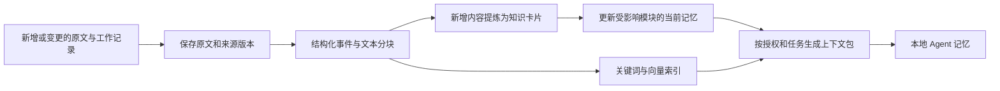

# 授权组装、分层记忆与随时交接方案

> v0.1｜2026-11-06（Asia/Shanghai）。依据用户关于独立仓库、专注模式、业务共享日志、持续提炼、节省 token 及离职交接的最新要求重新设计。
>
> 这是待实施方案。本轮未安装 pgvector、创建数据库、签发仓库权限或发布新客户端。当前工作区没有找到实际 `SKILL.md`；已核对 `install.md` 中的 `agent-doc-memory` 规范、现有设计及文档服务实现。

> 后续统一基线见[跨端协作 Skill 框架：生产实施基线](14_跨端协作Skill框架_生产实施基线.md)。本专题的原文存储与分层记忆继续适用；新增“每个改代码轮次记录并保全”的具体机制、任务身份提前落地、Git 访问和适配边界以统一基线为准。第 11 节旧实施顺序不再作为排期依据。

## 1. 建议采用的整体方案

**独立 Skill 仓库 + 各工程独立仓库 + 按业务授权的共享资料 + 服务器 PostgreSQL/pgvector + 本机按任务生成的精简记忆。**

项目组记录工程之间的关系；每个人在本机只拉取获准的工程。代码访问与业务资料访问分别批准。成员开始工作时，先获得本次任务所需的有效记忆和新记录，恢复本机上下文，再进入受管任务执行。

向量检索列入方案，向量数据库的能力先通过已有服务器 PostgreSQL 的 `pgvector` 扩展提供。pgvector 支持在 PostgreSQL 内保存向量并执行相似性检索，也支持和全文检索结合，符合复用现有数据库的方向。[pgvector 官方仓库](https://github.com/pgvector/pgvector#hybrid-search)

向量用于找相关资料。提炼、版本管理、任务状态和交接事实分别需要独立处理；不能从相似度推断任务已完成、决定仍有效或人员具有权限。

## 2. 原文、数据库和本地记忆各保存什么

| 内容 | 原件或权威记录 | 服务端保存与读取方式 |
|---|---|---|
| 通用 Skill、脚本、模板、框架规则 | 独立框架 Git 仓库的已发布版本 | 校验发行版本；不包含具体业务日志和成员凭证 |
| 工程代码、正式设计、接口及已审定决策文档 | 各工程 Git 仓库的指定版本 | 按提交读取，保存带内容哈希的原文归档副本及检索索引 |
| 经 MCP 接收的工作记录、任务事件、交接事实 | PostgreSQL 的追加记录 | 即时持久保存原文和结构化字段；自动导出为 Markdown，可归档到对应业务知识仓库 |
| 原有仓库工作日志 | 原 Git 版本及导入时的原文归档 | 保留来源，不改写成仿佛由平台新产生的日志 |
| 原文附件、未提交工作快照、较大版本归档 | 服务器受控制品目录中的完整文件及接收回执 | 数据库保存归属、哈希、访问范围和位置；需要时再引入对象存储 |
| 文本块、向量、知识卡片、当前摘要 | PostgreSQL 的可重建派生记录 | 与原文版本关联，按当前授权查询；摘要带生成状态及来源 |
| 本地角色、当前任务和精简记忆 | 工作区里的受管本地文件 | 从共享资料和当前任务生成，可重建；不作为团队唯一知识来源 |

**原文和每个接收版本保留，提炼结果另存。**不会用一份新摘要覆盖原文后丢掉历史。索引、向量或本地缓存损坏，可以从保留的原始记录重建。

同一数据不设置两个可随意互相覆盖的主来源。正式 Git 文档由 Git 版本决定；新工作日志以平台接收记录为准，导出 Markdown 是它的可读副本。Git 导出失败不撤销已经持久接收的工作日志，界面显示待导出状态。

备份覆盖数据库、原文归档、工作快照、回执及解密所需的受控密钥。仅备份向量索引或只有 Git，无法恢复完整交接状态。

## 3. 仓库和项目组怎样组织

```text
远端独立资源
├── agent-framework-skills         通用规则、安装和日常 Skill
├── product-web                    Web 工程
├── product-pc                     PC 工程
├── product-api                    服务端工程
└── business-knowledge             某业务可共享的规范、决策及日志导出

某个 Web 成员的本机项目组
├── 框架发布副本                   来自 Skill 仓库
├── projects/product-web/          只有获准的工程仓库
└── Agent文档/                     获准资料的索引、角色和本地精简记忆
```

图中名称仅为示例。原 `install.md` 的组级入口、Agent 职责、知识／经验／错误预防、链路与工作日志的职责继续保留，具体原文和状态改由上述来源承载。

项目组清单由服务端按本人权限生成，不通过克隆包含全部私有资源的大仓库来分发。每个工程有独立 Git 远端和凭证范围，不把多个独立仓库的 `.git` 数据合并到工作区根目录。

业务共享资料也不能依赖一个向所有人开放的全公司仓库来隔离敏感文档。不同访问范围可以使用不同资料源或由 MCP 单独控制；普通成员无需克隆完整业务知识仓库，按需取得授权片段即可。

## 4. 两类授权与专注模式

### 4.1 授权分别表达

| 授权维度 | 示例 | 不会自动附带的权限 |
|---|---|---|
| 工程／仓库访问 | Web 仓库读取、开发分支推送 | PC、API 等其他工程的代码权限 |
| 业务资料访问 | 业务 A 的共享日志、接口约定、有效决策 | 其他业务资料或日志中提及的受限代码 |
| 执行能力 | 认领任务、提交检查点、审查、发布 | 创建项目、增加授权或越过审批 |

超级管理员创建管理员和项目，批准首次授权、扩权与新设备。管理员在分配范围内申请授权，继续由超管审批；邮箱和设备验证规则沿用已确认设计。新增工程或业务资料源时，需要核对是否扩大已有授权范围。

Git 源自身也要落实对应仓库权限。建议后续使用 GitHub App，由服务器按已批准仓库和操作签发受限凭证或代理 Git 操作；必须显式指定仓库和权限，不能把安装实例全部权限默认分发给成员。GitHub 官方接口支持限制 `repository_ids` 和 `permissions`，安装凭证有期限。[GitHub App 凭证说明](https://docs.github.com/en/apps/creating-github-apps/authenticating-with-a-github-app/generating-an-installation-access-token-for-a-github-app)

Hub 停权与 Git 源权限回收分别记录，不能将 MCP 拒绝访问报告成所有 Git 通道已经撤销。仓库凭证不写入 Skill、业务文档、模型上下文或可提交的配置。

### 4.2 专注模式锁定本次开发范围

专注范围包括目标工程、允许修改的路径、目标端和功能边界。例如“本次只做 Web 登录”，即使本人还能访问 PC 工程，也不能据此增加 PC 登录、桌面打包或其他未约定功能。

实际开发范围需要同时满足：已审批权限、本次专注范围、当前任务范围。读取获准的业务资料用于理解，不因此取得修改其他工程的资格。越界依赖先记录和报告。

专注状态绑定工作上下文并持久保存，恢复会话、换设备接续和交接时继续携带。用户明确说“取消专注模式”后才解除专注限制；解除之后仍受人员授权和任务范围约束。架构师拆任务、同事日志和蒸馏出的记忆都不能自行改变它。

### 4.3 派生记忆也执行授权

共享摘要的可见范围不能宽于其来源的可见范围。包含受限工程细节的资料，不能因为被总结就进入面向整个业务的摘要。需要共享接口结论时，发布单独审定的业务资料，并明确其共享范围。

原文、向量、知识卡片、摘要、检索计数和本地上下文包均携带业务／仓库范围和权限版本。混合来源记忆按全部来源的访问要求校验；不能先检索全平台正文交给模型，再依靠模型自行忽略未授权内容。

## 5. 记忆分层

| 层 | 保存内容 | 什么时候读取 |
|---|---|---|
| 原始档案 | 全部原文、历史版本、完整日志、代码与工作快照引用 | 追溯原因、核实争议、需要细节时 |
| 知识卡片 | 一条决策、接口约定、踩坑、约束或可复用结论及其来源 | 按任务和模块筛选；用于形成摘要 |
| 当前业务／模块记忆 | 当前架构、有效决定、关键约束、已知风险、模块导航 | 开始工作时读取有关部分 |
| 当前任务／交接状态 | 谁在做、基于什么提交、最近检查点、尚未完成及下一步 | 认领、恢复、交接时必读 |
| 本地执行记忆 | 当前角色、专注范围、相关业务记忆、任务状态和引用目录 | 供本机 harness 恢复上下文；按增量更新 |

知识卡片至少记录原文 ID 和版本、引用位置、关联业务／工程／模块、内容、适用代码版本、证据状态、有效状态以及被什么记录取代。

状态区分待核实、已确认、存在冲突、已取代。模型从日志提炼出的推断不能自动变成已批准架构决策。任务是否完成、租约属于谁、测试是否通过，从结构化状态及证据读取，不能靠摘要自由推断。

本地可以继续使用 `Agent文档/main.md` 和 `doc_index.json` 作为简短入口及路由，但只列本人可见资源。正文按需加载，不复制全部历史。具体业务记忆保存在项目工作区，不修改全局通用 Skill 来记住某一个项目。

## 6. 持续提炼怎样工作



1. 新工作记录先持久保存，返回稳定事件 ID；提炼失败不丢原文。
2. 原文按标题、接口、决策及步骤分块，保留上下文标题和行位置。代码块、错误栈和关联解释尽量保持完整，避免只机械按字符截断。
3. 内容哈希未变的片段复用索引和向量。变更、删除和权限改变会使相关派生结果失效；旧版本保留为历史，默认不再当作当前事实检索。
4. 模型只处理新增或变更的有关内容。受影响的模块摘要从可追溯知识卡片及必要原文重建，不能长期只对上次摘要再摘要。
5. 对互相矛盾的日志保留来源并标为待处理，优先使用明确生效且有证据的决定；不能仅凭时间较新就把原决定覆盖。
6. 多人更新使用幂等 ID、预期版本和 Worker 领取代次；任务租约及交接事实通过数据库事务处理。
7. 分别记录原文已接收、索引处理到哪里、提炼到哪里、Markdown 导出到哪里。派生任务滞后时，上下文包带上尚未提炼的最新必要记录。
8. 模型／提示规则／分块策略升级时按受影响范围重新构建，保留生成版本和费用；不静默混用不同向量模型或维度。

重复的日常流水按主题合并为事实和变化，重要决定保留理由、约束、被否决方案及证据。原文不丢，当前摘要也有预算，不让模块摘要随年限无限增长；细节通过导航和检索访问。

## 7. 开工时怎样少读又读对

### 7.1 强制的准备流程

```text
检查版本、身份和资源授权
→ 恢复专注范围和任务
→ 获取当前模块记忆、重要约束、最近检查点及必要新记录
→ 按具体任务补检索，核对相关证据
→ 生成／更新本地角色和记忆，登记所用来源版本
→ 准备状态满足后进入受管开发与提交
```

“强制读取同事记录”落实为准备阶段和受管任务入口的校验：必须拿到任务必读资料、当前状态以及从上次水位之后的必要变化。新成员从有效基线加增量开始，已有成员按保存的上下文版本取变化，避免每次重读多年日志。

准备回执绑定本人、设备、执行实例、授权版本、专注范围、仓库提交集合和所用上下文版本。服务器可以验证所取版本及准备回执，不声称能验证模型内在理解；直接在不受管终端里的任意本地编辑也不因此被服务器全面控制。

### 7.2 必读资料和检索资料分别处理

权限、专注规则、任务验收、关键接口约定、相关生效决定、未解决阻塞和最近交接状态按明确关联加载，不能只依赖语义检索的前几名结果。相似搜索用于补充历史、理由、案例和细节。

检索逻辑为：授权与业务／工程范围约束 → 任务和模块定位 → 关键词及精确标识符查询 + 语义查询 → 去重合并 → 必要时重排 → 返回带来源的少量片段 → 按需展开原文。

关键词通道要实测中文、接口名、错误码、路径和两字短词。不能假设 PostgreSQL 默认语言配置已满足中文检索；可以结合应用侧中文分词、标识符匹配、短词字面回退和 `pg_trgm`。PostgreSQL 提供全文检索和三元组匹配能力，具体组合由本项目测试决定。[全文检索说明](https://www.postgresql.org/docs/current/textsearch-intro.html)、[pg_trgm 说明](https://www.postgresql.org/docs/current/pgtrgm.html)

代码仓库版本、文档快照和摘要覆盖水位不一致时显示差异；低相关分数或零条结果不能直接当作“从未有人做过”。找不到关键依据时继续展开查询，或记录交接缺口。

### 7.3 token 与费用控制

以下是首版待实测的预算建议，不是已经达到的指标，也不包含任务本身的代码和完整对话。

| 场景 | 初始预算建议 | 控制方式 |
|---|---|---|
| 新对话的项目／任务准备 | 约 3,000–6,000 tokens | 角色与范围、有关模块记忆、检查点和必要变化 |
| 为一个具体问题补证据 | 每轮约 2,000–6,000 tokens | 返回片段与引用，避免默认返回整篇原文 |
| 同一会话继续工作 | 优先复用已加载版本，只返回变化 | 不重复发送未改变的正文；上下文丢失时可重建 |

预算随任务复杂度调整。关键资料超出预算时返回覆盖情况与缺口，按需继续读取；不能为了满足固定长度而静默丢掉冲突、未完成事项或风险。

总成本同时计入开工上下文、查询、后台提炼、向量生成、必要重排及失败重试。增量处理、内容去重、同访问范围内共享模块摘要、相同上下文版本缓存，才有机会降低长期总费用。

本地存了 `memory.md` 后，将其送入模型仍有输入 token；不能把落盘误报为模型读取免费。具体 token 用目标模型的 tokenizer 或实际调用用量测量，不按中文字数简单换算，也不预先承诺某个节省百分比。

## 8. 离职或换人如何接手

### 8.1 平时就持续形成交接材料

每个发生代码改动的工作轮次均保存事实和工作笔记，并关联可恢复快照；失败、回滚净零、取消和中断也留痕。长任务在有意义的步骤、切换前及周期检查点额外保全，异常中断后如实标记说明待补。短周期本机自动保全作为补充，不能只保存一条“开发中”的心跳。具体状态机及覆盖边界见统一基线第 7 节。

检查点包含：任务及执行代次、代码基准提交、分支与当前提交、已提交和未提交改动、必要新增文件、运行和验证方法、证据、当前阻塞、相关决定、尚未完成和下一步。环境记录提供配置名称和取得方式，不导出真实凭证。

未提交工作用受控快照保存，不能只记录某个本机绝对路径或一段文字说明。快照经完整性校验、持久保存并登记有效回执后，才显示“此检查点可交接”。

### 8.2 离开后接手流程

```text
原成员离开／被移出
→ 普通权限停止，原执行租约和提交代次失效
→ 独立收尾流程尝试上传剩余工作
→ 超管批准接手人的工程和业务范围，项目管理员可以提交申请
→ 接手人拉取获准仓库及最近有效检查点
→ Skill 恢复有关记忆、变化和未完成任务
→ 新执行代次接续开发
```

接手人使用自己的身份和设备，不继承前任 Token、私钥或个人环境凭证。共享知识属于业务和项目资源，不以作者在职状态作为可见性前提；删除成员不级联删除其已交付日志和工作记录。

接手可以从最近已确认检查点开始，不必无限等待离线旧设备。旧设备后来补传的快照保留为独立待核对资料，不能自动覆盖接手人的新提交或恢复旧任务所有权。

**目标是人员可以立即退出，接手人能从最近已确认的工作状态继续。**断网设备里尚未上传的改动无法凭空恢复。界面必须显示最后可恢复时间、未确认上传及缺失信息；设备恢复在线后可以通过受限收尾身份继续上传。

上传失败保留工作并重试，持久回执确认前不卸载。卸载覆盖登记的完整框架和本地派生记忆，按授权范围和共享引用处理；移出一个工程不能删除仍获准的其他工程资料。

## 9. 数据库与服务部署

继续使用指定服务器上的 PostgreSQL 和 Docker。本机不安装数据库。新增能力放在现有 Agent Hub API、独立 Worker 及数据库内，先不增加独立向量服务、图数据库、消息集群或本地模型常驻服务。

| 模块 | 后续职责 |
|---|---|
| 资源与授权 | 项目组、独立工程仓库、业务资料范围、访问版本 |
| 原文与事件 | 不可变来源版本、工作记录、任务事实、归档及导出水位 |
| 记忆 Worker | 提炼、冲突标记、摘要发布、失效重建、向量计算与用量统计 |
| 查询与上下文 | 授权范围内混合检索、必读集合、预算、上下文准备回执 |
| 任务与收尾 | 原子认领、代次、检查点、快照回执、交接和卸载 |

新增逻辑实体至少需要：业务及工程资源、访问绑定、来源版本、文本块与向量、知识卡片与来源、摘要版本、工作记录、检查点及回执、上下文准备记录。任务状态继续使用结构化表，不能用向量相似性代替事务约束。

原文、卡片、摘要和向量相关表均要求服务端授权校验及项目／业务范围策略。PostgreSQL RLS 可以按行限制返回或修改，但角色、所有者例外及服务端上下文必须配置正确，不能把扩展本身当作授权实现。[PostgreSQL 行安全说明](https://www.postgresql.org/docs/current/ddl-rowsecurity.html)

数据量较小时先对已授权范围做精确向量检索，测量后再决定 HNSW 等近似索引。pgvector 的近似索引在过滤条件下可能返回不足结果，需验证过滤、扫描和召回行为，不能通过扩大结果可见范围来补足数量。[pgvector 过滤说明](https://github.com/pgvector/pgvector#filtering)

部署 pgvector 需要核对现有 PostgreSQL 主版本、镜像和资源，先备份、在服务器隔离测试库验证，再做正式扩展迁移；不重新初始化已有数据库数据卷。Embedding 与提炼模型分别可配置，需要以真实中文日志、代码标识符、成本及数据处理范围评估。所需模型凭证由后台受控配置，方案阶段不指定未经实测的硬件容量或效果承诺。

### 9.1 现有文档服务需要实际升级

当前实现只索引当前 Markdown 快照，不保存本方案要求的完整原文版本及长期记忆；还有限制为整仓 ZIP 32 MiB、最多 1000 篇和正文总计 8 MiB。它适合首版文档查询，不能直接承诺承载两年的持续增长。

后续按已登记仓库、提交和允许路径枚举变更并分批读取有关原文，增加不可变版本与归档，再分别更新当前检索视图；不能靠不断提高整仓 ZIP 上限解决长期记录问题。接口截断、分页、单文件大小、单批用量和归档保留都需要明确处理。文档服务仍不执行仓库脚本。

旧框架的 `doc_index.json` 和结构化工作日志按明确格式提供受限导入与路由；当前 Markdown 工具不具备这些能力。不能为兼容旧格式而开放读取任意 JSON 配置或把正文当成执行指令。

## 10. Skill 和原 install.md 怎样衔接

| 原机制 | 后续职责 |
|---|---|
| `install.md` 部署规范 | 保留组级结构、角色、流程和记忆职责；明确独立仓库及授权来源 |
| 安装 Skill `agent-framework-setup` | 获取获准资源清单、拉取工程、配置 harness、生成本地入口和部署归属清单 |
| 原约定的 `agent-doc-memory` | 作为日常入口，执行版本／权限／专注／上下文准备、按需取证、工作记录、检查点及交接 |
| 早期设计里的 `agent-project-workflow` | 日常协作职责合并到上述入口，避免安装两套同时维护任务和记忆的 Skill |
| `main.md` | 本人当前项目组的简短导航和有效约束；不塞全部业务历史 |
| `doc_index.json` | 授权资料和本地映射的可重建路由；受管入口需增加版本化 MCP 对应能力 |
| 知识库、经验库、错误预防 | 对应可追溯知识卡片和有关模块记忆，可导出 Markdown |
| 角色与链路 | 仍由原框架定义，用当前任务和获准资料实例化；不把每个历史角色全量加载 |
| 工作日志 | 经 MCP 及时接收、服务端保存原文、增量提炼、生成共享读取视图 |
| 宿主实时计划 | 管当前执行步骤；平台保存跨设备可恢复的任务和检查点 |

Skill 仓库只带简短入口、必要脚本、按需参考资料及模板。不会把用户两年的日志打包到 `SKILL.md`；多个 harness 的适配层指向同一组业务协议与服务，各自接入能力按实机验证。

旧项目首次导入可以按照原规范做一次代码与资料分析，形成带来源的初始基线并记录实际成本。以后根据提交、变更文件和新增事件增量更新；新成员接手复用已有业务记忆，按任务补读代码，不重新执行每个人一遍的全仓深度分析。任何摘要和同事记录都作为业务资料使用，不能覆盖授权、专注约束或上层指令。

所需新增 MCP 能力包括获准资源清单、准备工作上下文、范围化取证、记录工作、保存检查点和交接。具体名称及接口在实现时确定；当前已有工具仍限于项目、文档、进度和客户端版本检查，不能让尚未实现的工具冒充可用接口。

## 11. 实施顺序与验收

| 阶段 | 交付 | 必须验证 |
|---|---|---|
| 1 | 项目组／独立工程／业务范围与授权组装 | Web 成员只能拉 Web；业务资料另授；取消专注不增加权限；专注 Web 不产生 PC 任务 |
| 2 | 原文接收、工作记录、检查点与原始档案 | 原文可完整恢复；响应丢失可幂等重试；未提交工作有有效回执，成员离开后材料仍在 |
| 3 | 知识卡片、模块记忆、关键词和 pgvector 检索 | 来源可追溯、冲突可见、中文可查、精确标识符可查、权限过滤无泄漏、增量提炼可重试 |
| 4 | Skill 安装与本地准备流程 | 空白新设备按授权组装项目组；开工恢复同事记录；上下文预算和变化水位可见 |
| 5 | 任务竞争、实际交接与完整退出 | 同人不同 harness 竞争不双领；陌生接手人用自己的身份从最近回执继续；断网不先删文件 |
| 6 | 年级别历史、客户端与恢复验收 | 同一任务比较不同方案的质量与总费用；真实双设备和目标客户端验证；完成备份恢复 |

核心验收场景：

- 同一业务存在 Web 与 PC 仓库，成员只有 Web 代码权但有业务共享日志权，不能获取 PC 代码或受限摘要。
- 生成摘要后来源权限收紧，后续检索、上下文缓存和本地恢复不能继续分发旧的越权结果；已下载副本按收尾策略处理。
- 早期决定被新决定取代，检索默认给有效版本，并可追溯过去为什么改变；模型摘要错误可以回滚和重建。
- 两年历史中有一条仍有效的关键限制，不能因时间久远或向量分数不高而从必读集合消失。
- 提炼 Worker 落后时，接手人仍看得到最新未提炼的重要日志和检查点，界面不伪报资料已全量处理。
- 工作代码尚未提交但已完成快照回执，移除原成员后新成员能恢复这些改动、验证结果及下一步。
- 新接手人用清洁工作区完成预设修复任务，不依赖前任聊天记录或私下补充信息；记录遗漏、查询次数、结果正确性和总 token。

费用评估同时比较：全量原文读取、关键词检索、关键词加向量、分层记忆加混合检索。使用同一批任务、同一权限及相同有效事实作为基线，不能只用“压缩了多少文字”证明交接质量。

## 12. GitHub 参考项目与选型边界

| 项目 | 可以借鉴什么 | 本方案的取舍 |
|---|---|---|
| [pgvector](https://github.com/pgvector/pgvector) | 在现有 PostgreSQL 内保存向量及组合检索 | 作为首版向量能力，减少额外服务；上线前在现有环境验证 |
| [Mem0](https://github.com/mem0ai/mem0) | 将历史交互转成可新增、查询的持久记忆 | 借鉴记忆管理流程；不照搬其账号或授权体系，也不移交业务数据到第三方平台 |
| [GraphRAG](https://github.com/microsoft/graphrag) | 从资料抽取结构化关系，辅助跨材料查询 | 首版先维护明确的工程、任务与决策关系；其官方提示索引可能昂贵，暂不对全部历史做完整图提取 |

上表为基于官方能力说明的设计选择，不代表这些项目已在本系统接入或通过用户业务数据测试。首版先把原文保全、授权、有效记忆和交接闭环做完整，再根据实测决定是否增加专用向量服务或更复杂的知识图谱。
