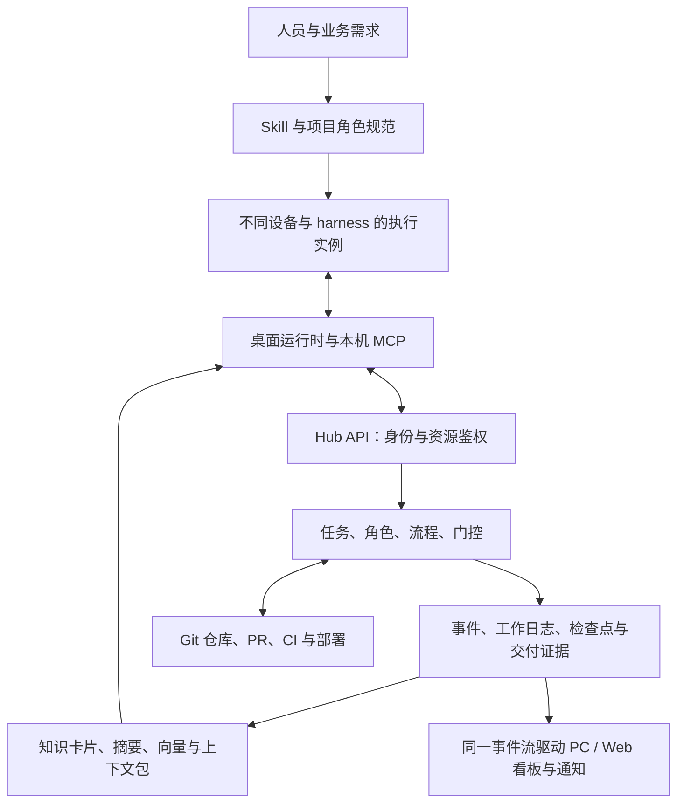

# 跨端多 Agent 协作平台：全项目总审计与实施路线

> 2026-11-08，Asia/Shanghai。依据原 `install.md`、当前代码、指定服务器实查和官方资料。
>
> 正式运行：服务端 **0.3.2 / 迁移 0006**，Windows 稳定渠道 **0.5.0**。
> 本地开发：桌面端 **0.6.0**、一体安装入口和基础 `agent-hub` Skill。已完成部分验证，**尚未打包发布，不能当作正式可安装版本**。
>
> 本文记录本轮整改前的审计快照及完整目标；后续实际交付以 [20 号整改复评](20_任务协作落地与复评.md) 为准。服务端现已推进到 0.4.0 / 0007，任务、租约、原文日志和共同看板的变化详见该记录。第 13、14 号文档保留为记忆和协议细化依据，本文中的“目标”“拟新增”“验收要求”均不代表已实现。

## 1. 总结论

目标应完整定义为：**有人员和仓库授权、有项目组与角色分工、有任务流程、有持续工作记录和可恢复交接、有分层记忆，并能在 PC/Web 查看同一份真实进展的跨端协作平台。** Skill 是工作方法入口，MCP 是工具连接，桌面端是本机运行与凭证入口，服务器负责共同状态和权限。

目前已经具备身份、设备授权、文档索引、进度上报与 PC 通知等基础。任务与流程引擎、原 install 的角色运行体系、每轮自动记录、自动记忆和向量检索仍未落地，**尚不能按完整协作平台交付生产**。一键安装解决接入体验，不能证明后面的协作功能已经完成。

后续开发应围绕一条真实业务链验收：

```text
安装与登录 → 获准项目组和仓库 → 项目经理/架构师拆解
→ 执行实例认领 → 加载角色、专注范围与必要记忆
→ 开发并持续记录、保存检查点 → 审查 → 测试 → 发布审批
→ Git/PR/部署结果关联 → 更新项目进展 → 提炼记忆 → 随时交接
```

## 2. 当前能力总账

| 能力 | 当前实际状态 | 距离目标还差什么 |
|---|---|---|
| 超管、管理员、成员、邮箱和设备审批 | 正式服务已有 | 流程职业角色不能混同账号权限 |
| 项目创建 | 正式后台及 0.5.0 管理 MCP 已有 | 当前是平台项目记录，未组装项目组代码 |
| 多子项目、多仓库及分别授权 | 方案已有，运行模型未完成 | 工程/仓库/分支/日志等资源授权与投影工作区 |
| 文档存储和查询 | GitHub Markdown 索引、手动同步、文字片段搜索 | 多源、版本归档、自动增量、混合检索 |
| 向量数据库 | **未搭建** | 正式镜像中连 `vector` 扩展文件也不存在 |
| 工作日志自动生成 | **未实现** | 宿主事件适配、本地运行时、轮次和检查点协议 |
| 工作记录实时共享 | 已主动上报的进度可共享 | 尚未上报的文件、代码和日志不会自动共享 |
| PC 进度展示与推送 | 已有项目进度流、托盘通知，展示最近 100 条 | 没有流程门控、完整任务和提交时间线 |
| Web 流程与任务看板 | **未实现** | 当前是账号、项目、文档、审批和操作审计后台 |
| 原 install 的职业 Agent 与链路 | 文档规范已有 | 角色注册、实例、模板部署、流转、门控证据 |
| 多人/多 Agent 原子认领 | **未实现** | 任务、执行实例、租约与接手代次 |
| 自动提炼、开工自动加载记忆 | **未实现** | 原文版本、知识卡片、上下文包、加载回执 |
| 专注模式 | 原规范和新 Skill 有指令 | 尚未形成按会话/执行实例隔离的受管范围 |
| 每次 Git 提交与任务日志关联 | 进度报告可手填 SHA | 没有 Git 观察器、提交校验、Webhook、PR/CI 映射 |
| 离线日志待发与工作快照 | **未实现** | 加密待发队列、完整快照、持久上传回执 |
| 退出/撤权后上传并完整卸载 | 平台调用拦截已有；上传卸载未实现 | 限定收尾通道、完整部署清单和恢复重试 |
| 自动更新 | Windows 桌面与桥接更新已有 | 已安装 Skill、宿主规则和项目模板还未统一自动更新 |
| 一体安装 | 本地 0.6.0 开发中 | EXE 打包、真实安装、签名渠道发布和仓库发布待完成 |
| 跨系统和七种 harness | Windows 有基础；三个工具的安装配置在开发验证 | macOS、其余四种宿主及实际多设备验收 |

特别区分：文档索引的 `snapshot_id` 不是未提交代码快照；文档 Worker 的内部租约不是开发任务认领；账号操作审计不是完整工作日志；进度报告写了 `completed` 也不代表已经通过审查和测试门控。

## 3. 本次核实依据

### 服务器实查

- PostgreSQL **18.6**；已安装扩展仅 `plpgsql`，`pg_available_extensions` 中没有 `vector`。
- 数据库容器上限 **512 MiB**，`shared_buffers=64MB`，`max_connections=40`。API 和文档 Worker 正常运行。
- 正式表包含 `projects`、`project_progress`、文档索引、身份和审计等；未发现任务、工作轮次、流程、记忆或向量实体表。`outbox_events` 当前用于邮件投递，不能算已建通用协作事件总线。
- 主机约 **3.6 GiB RAM**，本次读取时可用约 **1.9 GiB**，磁盘剩余约 **26 GiB**。这只证明当前空闲情况，不是负载承诺。
- 系统为 **CentOS 7.9 / 内核 3.10**。CentOS 7 已于 2024-06-30 结束维护，正式生产规划必须纳入系统迁移。[CentOS 官方说明](https://www.centos.org/centos-linux/)
- 已有部署前数据库备份；本次未执行恢复演练，也未证明异地备份和确定的 RPO/RTO。已确认的系统定时器负责 IP 证书和更新清单核验。
- 正式健康接口返回 `0.3.2`；稳定更新清单返回 `0.5.0`，不是本地正在开发的 `0.6.0`。

### 源码依据

- [models.py](../projects/agent-hub/src/agent_hub/models.py)：`ProjectProgress` 只有摘要、详情、状态、任务文字引用和可选 SHA 等字段；没有任务/角色实例/轮次/交付物关联。`DocumentRepository.project_id` 是主键，一个平台项目目前只能有一个文档源。
- [progress.py](../projects/agent-hub/src/agent_hub/progress.py)：明确实现追加式进度报告，不实现任务所有权。
- [api.py](../projects/agent-hub/src/agent_hub/api.py)：有进度查询、报告、SSE；空闲时每两秒查询下一批，并重新核验权限。没有任务流程、记忆或 Git Webhook API。
- [documents.py](../projects/agent-hub/src/agent_hub/documents.py)：使用文字片段匹配，没有向量或语义检索。
- [Web 界面](../projects/agent-hub/src/agent_hub/static/app.js)：没有项目进度 SSE、任务详情或流程看板。
- [PC 界面](../projects/agent-hub-desktop/renderer/app.js)：展示已上报进度，尚没有角色队列、门控与提交记录页面。
- [会话启动钩子](../projects/agent-hub-desktop/core/session-hook.cjs)：目前检查版本，没有加载记忆。
- 本地 0.6.0 的 [基础 Skill](../skills/agent-hub/SKILL.md) 提供工作记录指令，[安装接入连接](../projects/agent-hub-desktop/core/setup-connection.cjs)提供接入工具；没有实现原 install 的完整运行体系。

### 验证边界

本地 0.6.0：56 项桌面测试通过；PowerShell 5.1 的缓存、下载哈希、大小、跳转、地址及文件树检查通过；Skill 格式校验通过；真实 Electron、真实 stdio 和隔离 HTTP 替身完成登录、建项目、接入、读文档、报告流程；Codex CLI 能识别生成的配置。**这些没有使用正式业务库完成开发协作验收，也没有启动七种实际宿主或两台物理设备。** 后端之前的 71 项测试记录保留，本轮未重跑或改动正式后端。

## 4. 总体架构与事实源

下面是目标架构，其中任务、流程、自动记录和记忆部分尚待实现。



| 数据 | 权威来源 | 其他位置的作用 |
|---|---|---|
| 代码、角色/规范、业务 Markdown | 各自 Git 仓库及明确版本 | 平台保存索引与可追溯快照 |
| 身份、授权、任务、租约、门控与事件 | PostgreSQL 事务状态 | UI、Markdown 看板为投影 |
| 新产生的日志原文、未提交工作快照 | 持久原文对象及校验哈希，数据库保存引用 | 可异步导出 Markdown/Git，导出水位单独显示 |
| 知识卡片、当前摘要、向量 | 有来源版本的派生数据 | 可重建，不能替代原文 |
| 本地角色和记忆上下文 | 本人获准数据的运行缓存 | 按执行实例和授权版本隔离 |

原文接收、索引完成、提炼完成、导出 Git、客户端加载分别记录水位。向客户端确认“已保存”前，必须持久保存相应原文和事件引用；不能仅因排入内存队列就确认成功。

首期复用现有 PostgreSQL、API 与受限 Worker；私有快照先用有备份的受控存储接口，规模扩大后可接对象存储。没有证据需要一开始引入另一套向量服务、消息集群和多套任务数据库。

需新增的最小实体族包括：工程/仓库/日志资源与授权；角色版本与流程版本；任务及依赖；执行实例与租约；工作轮次、日志原文和检查点；提交/评审/测试/发布证据；知识卡片/分块/向量作业；上下文包和准备回执；部署清单与退出作业。

贯穿数据链的引用至少有 `project_id`、`resource_ids`、`task_id`、`run_id`、`turn_id`、`workflow_version`、`focus_version`、`lease_epoch`、`snapshot_id` 和 `context_version`。按事件类型允许部分字段为空；人员、设备和权限由服务器确认，不能信客户端自填身份。

共用事件包含稳定 `event_id`、服务器序号、类型、对象版本、来源、范围和证据引用。任务状态、事件记录和待投递项在同一数据库事务中提交；PC、Web、记忆 Worker 从这份事件消费。邮件队列与协作事件分别授权，不直接把邮件 Worker 变成可读取全部业务的后台账号。

## 5. 项目组、资源、权限与专注

核心对象关系：

```text
超级管理员
└── 项目组（也可只有一个工程）
    ├── 一个或多个项目管理员、成员与批准设备
    ├── 工程/仓库/分支/模块/目标端资源
    ├── 独立授权的业务日志与文档资源
    ├── 角色与流程模板
    └── 任务 → 执行实例 → 轮次 → 检查点/日志/提交/评审
```

平台身份、职业角色和实际执行者分别建模。项目经理是流程职业，不会因为这个名称获得超管签发 Token 或其他仓库读取权。

沿用已确认的账号规则：项目和管理员账号由超管创建；项目管理员可发起授权申请，超管审批后生效；已批准会话可以续期；首次授权、增加权限及新设备按规则审批。管理员必须有邮箱，普通成员可选；绑定邮箱的新设备先验证邮箱。超管本人通过密码和本设备邮箱验证码确认，不能再要求另一个不存在的超管来批准。

代码仓库访问与业务记录阅读分别授权。有 Web 仓库权限只组装 Web 工程；获准业务日志后才能读取相应共享记录。混合多个受限来源的摘要、向量和缓存，默认继承来源权限的共同限制，不能靠“摘要”把代码信息扩散到更广人群。扩大共享范围需要明确受控的审核。

专注范围绑定 **执行实例/对话**，包含工程、仓库、分支或工作树、目标端、功能和可写路径。`main.md` 可保存公共规则和导航，不能保存所有人共用的唯一专注开关。不同设备、两个本地对话和不同职业各自有范围；取消专注不会取消服务器授权边界。

Git 本身也要限制仓库权限。当前电脑上的 GitHub 全局认证属于账号持有人，不是可发给所有成员的仓库网关。GitHub App 或逐仓库受限凭证的自动化接入要实际缩小仓库集合；成员直接访问 Git 时也不能取得其他仓库代码。

## 6. 跨端协作与本端多职业

执行实例至少关联：人员、设备、harness 与版本、会话、工作区、角色版本、任务、授权版本、专注范围、租约代次及心跳。

目标宿主明确为 **Claude Code、Codex、Cursor、Qoder、WorkBuddy、CodeBuddy、Trae**。当前项目的适配状态为：

| 宿主 | 已有或正在验证的接入 | 仍未完成 |
|---|---|---|
| Codex | 通用 stdio；版本启动钩子导出；0.6.0 配置被实际 CLI 识别 | 记忆/轮次 Hook、本端职业编排、完整流程验收 |
| Claude Code | 项目 `.mcp.json` 写入；版本启动钩子导出；0.6.0 用户配置合并测试 | 实际客户端新版本验收、记忆/轮次 Hook、角色运行 |
| Cursor | 通用配置复制；0.6.0 JSONC 配置合并测试 | 实际客户端验收、生命周期事件和角色运行 |
| Qoder / WorkBuddy / CodeBuddy / Trae | 当前提供通用配置作为接入材料 | 专用适配器、Hook、角色事件和每个版本的实际验收 |

根据当前本机路径和管道桥接实现，不能直接推定 WSL、远程 SSH、开发容器或云端 Agent 能执行同一份本机配置。执行环境与安装桌面所在设备应分别登记，按宿主实际传输能力测试；不要把本机私钥复制到远程来绕过接入问题。现有鉴权是本机 stdio 加内部设备会话协议，远程 MCP 与标准 OAuth/PKCE 需要另外实现和验收。

| 维度 | 目标能力 | 不能混淆的地方 |
|---|---|---|
| 跨设备 | Windows/macOS 上的人或 Agent 接力 | 本机两个测试身份不等于已做两台物理设备验收 |
| 跨 harness | 七种工具通过同一协议读任务与交接 | 通用 MCP 可连不等于生命周期 Hook 和子 Agent 都已适配 |
| 本端多角色 | 主执行者按项目角色模板拆出架构、开发、审查、测试等工作 | 单个 Agent 换称呼做自检，不等于独立审查实例 |
| 跨工程 | 项目组内按授权处理 Web、后端等依赖 | 不因任务涉及同一业务就下载全部仓库 |

保留原 install 的项目经理、设计、开发、审查、测试、运维等领域；按真实工程补充产品/架构、Web、服务端、桌面等角色。角色文档包括职责、上下游、输入、产物、允许范围和门控。导入 `roles.json` 后校验角色标识唯一；不把示例编号或空占位符当作已经部署的 Agent。

有原生子 Agent 能力的宿主，适配层登记真实子实例及其任务和证据；缺少该能力的宿主采用显式角色任务和跨会话接力。跨应用协作依靠公共任务状态，不依靠模拟鼠标操作操控所有客户端。

审查可以是独立 AI 实例，也可以是有权人员，项目策略明确区分。相同执行者对自己的产物做检查可记为自检，不能伪造独立批准。单人项目若允许特定人工覆盖，必须有明确理由和审计。

## 7. 原 install 的流程与七个门控

将原来的“职责文档 + 链路 Markdown + G1—G7”同时落实为可读规范和服务器状态机。

| 门控 | 应有证据 |
|---|---|
| G1 需求确认 | 已确认的目标、验收标准和范围版本 |
| G2 设计评审 | 有版本的设计、接口影响及评审记录 |
| G3 可行性 | 依赖、环境、风险及实际验证依据 |
| G4 开发准入 | 资源授权、有效执行代次、专注范围、上下文加载回执 |
| G5 代码质量 | 对明确快照的审查、问题处理与审查者身份 |
| G6 测试通过 | 与该交付快照一致的测试、环境和结果；未覆盖部分单列 |
| G7 发布批准 | 本次批准内容、发布人、部署结果及回滚方案 |

流程模板定义适用门控、审核者、超时、打回目标和重试上限。小任务可使用已批准的精简流程，并记录不适用的原因；Agent 不能自行删去门控。代码或范围变化会使相关旧证据失效。达到重试/超时上限后保全并上报，不能无限循环或删除失败记录。

一个任务的主写入执行者通过数据库原子认领。同一任务可以有只读观察、审查或测试实例，但不能有两个同时有效的主开发租约。人和 Agent 使用同一套认领规则；接手增加执行代次，旧实例迟到的提交不能覆盖新所有者。

角色职责、链路、项目目录、`main.md`、`doc_index.json` 和宿主入口仍需完整部署器生成并登记归属。目前 0.6.0 的客户端安装不生成这套工程框架。生成内容必须来自真实项目资料，空工程标明待验证，不编造“已有经验”。

## 8. 每轮工作日志与实时共享

“实时”至少包含三个阶段：本机发现变化、服务器确认接收、其他设备看到。不能把这三件事统一写成一个“已同步”。

目标规则：

1. 开始任务/轮次时登记 `task_id`、`run_id`、`turn_id`、角色和基准提交。
2. 宿主事件或受限目录观察器标记代码变化；只监测批准根目录，排除凭证和无关目录。
3. 有代码变更的轮次结束前，自动生成最小工作笔记及可恢复检查点。失败、中断、交接也形成记录，不等任务全部完成才写。
4. 原文与快照先持久保存，再返回带哈希、范围和事件号的回执。通过回执和证据允许流程推进。
5. 日志接收与任务状态更新在事务中产生协作事件，事件投递驱动 PC/Web；提炼与向量生成在后台执行。
6. 断网写加密本地待发队列，恢复后按幂等 ID 补传。界面显示未确认状态；服务器离线时只能显示最后确认点，不能假装掌握尚未收到的工作。
7. 采用至少一次投递、稳定事件 ID、游标与客户端去重。不能承诺网络事件永远不重复，只能正确处理重复。

每条笔记至少关联目标、改动文件、决定及依据、验证、当前状态、未交付内容、下一步、快照和提交引用。保存可交接的事实与工作证据，不要求保存模型隐藏思考。高频技术事件可以连续入库，系统弹窗只聚合重要阶段和待办。

当前 Skill 中“修改代码后记笔记”只属于 Agent 指令。实现 Hook、记录运行时和服务器门控之前，不能称为已强制自动记录。即使完成受管门控，也不能全面控制用户在不受管终端的任意文件编辑。

事件覆盖轮次开始、上下文已准备、任务认领、代码变更检查点、日志已接收、提交已核验、审核/测试结果、阶段推进、阻塞/退回、发布和交接。以每个修改轮次保存的最小记录为基线，重要中间节点追加检查点；不上传每次按键或每个模型 token 来制造大量无用日志。

## 9. 每次提交、任务日志与项目进展

必须区分：**本地检查点、本地 Git commit、push 到远端、PR 合并、发布到环境**。它们各自生成事件，不能把其中一次成功当作所有阶段完成。

桌面端在已登记工程观察 Git 变化并增量核对；GitHub 接入接收 push、PR、检查与部署事件，辅以授权轮询补偿。Webhook 必须验签、去重和防重放，不能只信客户端提交的 SHA。[GitHub 验签说明](https://docs.github.com/en/webhooks/using-webhooks/validating-webhook-deliveries)

每次提交记录关联仓库、分支、SHA、父提交、变更文件摘要、对应任务/轮次/日志、作者与执行身份、测试和评审。Git 作者字段与平台登录人分别保存；未能归属任务的提交进入待关联列表，不能自动编造任务。

Webhook 的单次 push 提交列表有上限，必须能按 API 补齐，并处理强推与重复投递；当前 IP/端口的实际回调投递也要验收。[GitHub push 事件](https://docs.github.com/en/webhooks/webhook-events-and-payloads#push)

当前只支持手填 SHA，格式合法并不证明仓库中确实存在该提交。未来完成状态应绑定明确的交付快照、评审和测试；项目进度从已验收任务及流程状态计算。Agent 的自由文本百分比只能作为报告，不能直接改写管理看板的已完成比例。

## 10. 分层记忆与自动加载

建议保留五层：原始记录与历史 → 可追溯知识卡片 → 当前业务/模块摘要 → 任务和交接状态 → 本地执行上下文。

自动处理链：

```text
新原文/提交/评审事件
→ 保存来源版本 → 分块、去重、分类 → 增量索引和提炼
→ 更新受影响模块的当前记忆
→ 按授权、任务、角色与专注范围组装上下文包
→ 宿主启动/恢复时加载并登记回执
```

卡片保留来源、行位置、适用代码版本、确认状态、冲突及被取代关系。任务归属和门控是否通过从结构化状态读取；模型摘要不能决定这些事实。不能永远只对旧摘要再摘要，应能从原文和有效卡片重建。

开工必须加载当前任务验收、有效约束、相关接口决定、未解决阻塞及最新交接。历史经验再用检索补充。尚未提炼的新日志作为必要增量进入上下文，避免“向量还没完成，所以同事刚写的记录消失”。

本地上下文带 `run_id`、角色、授权版本、仓库提交集合、文档/记忆版本、水位和来源引用。同一目录的两个对话不能覆盖一个全局 `current-memory.md`；使用实例级文件与宿主会话映射。授权变化使相关缓存和准备回执失效。

提炼有两种执行位置：服务器调用已配置的模型服务，或由有相应资料权限的 harness 认领提炼作业、提交带来源的候选卡片。两者走相同版本、审核和费用记录；没有持续运行的执行者或模型服务时只能明确显示待处理，不能声称后台已经自动提炼。GitHub、Hub 登录和模型服务的凭证分别管理。

原 install 的项目级 `agent-doc-memory`、定位脚本和 `doc_index.json` 路由仍需承接。建议保留 `agent-hub` 为安装/接入入口，项目级记忆入口按原规范部署；由同一个安装过程处理，不增加用户操作次数。各职业作为按需角色资料，不注册一大批互相竞争的常驻 Skill。

Skill 存在于磁盘不等于每轮已经加载。需要宿主启动/恢复适配和 `prepare context` 回执；服务器可验证取用了哪些版本，不能验证模型内在“已经理解”。本地记忆送入模型仍占 token。

成本按前台上下文、检索、提炼、embedding 和重试分别计量。可沿用第 13 号方案的初始预算：新任务准备约 3,000–6,000 tokens，按需补证据约 2,000–6,000；同一会话优先仅发变化。预算是待实测起点，不承诺固定节省比例，也不为省 token 静默丢掉必要约束。

## 11. 向量数据库怎样搭建

推荐在**指定服务器现有 PostgreSQL 内使用 pgvector**。原文和事务状态继续按前文保存；向量负责语义召回，与路径/接口名/错误码等精确查询及关键词通道组合。

### 安装和迁移

1. 保持现有 PostgreSQL 18 系列与数据卷布局，制作固定版本、可核验来源的 pgvector 候选镜像；不能直接在活容器中临时装包后当成可复现部署。上游提供 PostgreSQL 18 的安装与镜像方案。[pgvector 官方仓库](https://github.com/pgvector/pgvector#installation)
2. 在服务器隔离测试环境验证扩展、备份恢复、现有迁移和 RLS，再安排正式镜像切换；不在本机装数据库或 Docker，不公开数据库端口。
3. 独立迁移新增来源版本、分块、模型版本、embedding 作业及记忆实体。扩展安装成功后才执行相应建表与 `CREATE EXTENSION`。
4. 固定 embedding 服务、模型、维度、分块规则和生成版本，先做少量中文需求、代码标识符与历史交接查询评测。模型升级建立新索引版本，不混用向量。
5. 再启用增量提炼和检索。原文、关键词查询先可用，模型或向量作业失败时明确显示滞后，不能影响日志原文保存。

### 权限和资源

每个来源、分块、摘要和向量携带项目组及资源范围。检索在授权范围内执行；普通 API 角色不能使用超级用户或 `BYPASSRLS`。向量表也要强制 RLS；PostgreSQL 超级用户能绕过 RLS，不能把“建了策略”当作所有连接都受限。[PostgreSQL RLS](https://www.postgresql.org/docs/18/ddl-rowsecurity.html)

先做授权集合内的精确召回与正确性评测，再按规模启用近似索引。近似检索叠加过滤可能返回不足，应测迭代扫描或分区，不能扩大读取范围凑结果。[pgvector 过滤说明](https://github.com/pgvector/pgvector#filtering)

当前主机与数据库限额适合小范围验证，不能直接承诺长期多人生产规模。1024 维、10 万片段仅 float32 向量原值就约 391 MiB，尚不含文本、索引、WAL 和备份。按实测调整内存、共享内存、连接和磁盘预算；embedding 模型不默认与数据库挤在这台主机中运行。

embedding 与提炼服务目前没有选定或配置。将模型端点、密钥、预算和允许发送的数据范围放在受控后台配置；不放 Git、Skill 或安装包。具体模型以中文/代码/交接检索评测确定，不能只安装扩展就宣称有了自动记忆。

## 12. PC / Web 应显示同一份什么

两个界面使用同一任务/事件 API 和状态定义，避免 PC 一套进度、Web 另一套进度。

| 页面 | 应能看见 |
|---|---|
| 项目组总览 | 授权范围内的子项目、阶段、已验收进展、依赖、阻塞及待批准事项 |
| 任务板 | 拆解关系、主执行者、职业、设备/harness、认领与离线状态、最近确认点 |
| 任务详情 | 需求、设计、每轮日志、改动与快照、测试、评审、退回、交接和发布 |
| 提交时间线 | commit、push、PR、CI、部署分别标记；关联任务与日志，展示待核验记录 |
| 知识与记忆 | 原文来源、摘要版本、权限范围、提炼/索引水位和上下文加载记录 |
| 管理与异常 | 设备、授权、上传待确认、撤权收尾、同步失败、告警和审计 |

通知覆盖任务分配、认领冲突、阶段推进、审核请求、退回、阻塞、测试/发布结果、交接和撤权。高频普通日志聚合通知；原事件不丢。桌面后台退出后不能继续依赖它发送本机通知；浏览器关闭后的通知属于另一项能力，不能把打开页面的 SSE 当成已做 Web Push。

版本更新也需要进入工作状态机：先检查新版本并准备下载，完成当前轮次的持久检查点和待发处理后再切换程序。发行清单关联桌面、MCP、Skill、模板、适配器和协议的兼容版本；受管原件可更新，用户修改过的规则需保留并处理冲突。更新门控不能阻止必要的工作保全和限定收尾。

同样的授权过滤适用于看板、推送摘要、日志正文、向量和下载。拥有某个仓库代码权限，不自动意味着能看全部业务日志；获准的业务摘要也不能夹带无权查看的工程原文。

## 13. 撤权、收尾与卸载

目标状态机：有效 → 撤权/冻结 → 普通操作拦截 → 限定收尾上传 → 持久回执 → 按部署清单完整卸载 → 上报结果。

收尾通道仅能上传该实例已产生的工作，不重新开放正常开发权限。离线或上传失败时保留受控待交付材料并重试；没有持久确认不销毁唯一副本。断网设备只能在重新联网、心跳或调用时得知撤权。

卸载清单必须覆盖该项目部署的入口、Skill 连接、规则、脚本、角色与流程文档、框架测试、缓存和索引等全部受管文件。对用户原有文件采用归属和修改回执，不按文件夹名称盲删。Agent 指令和确定性脚本共同执行，服务器保存确认链。

**需明确的共用组件策略**：建议项目撤权清理该项目全部落地框架及缓存；其他获准项目仍使用的全局桌面端和通用 Skill 保留。全账号退出或没有其他项目依赖时再执行全局清理。不能因踢出一个项目就意外破坏其他项目。

MCP 能拒绝服务器请求，不能远程保证删除用户已经复制的数据、所有离线文件或不配合的设备。受管卸载是有结果记录的协作流程，不能作为仓库和数据权限的替代措施。

## 14. 需要整改的主要问题

| 优先级 | 问题 | 修复落点 |
|---|---|---|
| P0 产品 | 已发布、开发中、目标功能容易混写 | 能力总账、发布清单与界面只展示实际可用能力 |
| P0 数据 | 项目组内资源授权未建，不能安全混合全部代码、日志与记忆 | 先建工程/仓库/日志资源和派生权限模型 |
| P0 协作 | 没有原子认领、角色实例与流程状态 | 任务/执行/租约及版本化工作流 |
| P0 交接 | 没有逐轮记录与可恢复快照闭环 | 本机运行时、待发队列、检查点和回执 |
| P0 知识 | 没有自动加载、蒸馏与向量 | 来源版本、增量 Worker、上下文准备协议 |
| P0 运维 | CentOS 7 已结束维护；备份恢复和容量未完成验收 | 主机迁移、恢复演练、告警与容量测试 |
| P1 展示 | PC 只有报告流，Web 无统一任务/流程页面 | 公共任务/事件 API + 两端一致投影 |
| P1 证据 | 手填 SHA、文字任务引用可被误认为完整提交链 | Git 采集、服务器校验、PR/CI/交付物关联 |
| P1 能力 | 界面出现任务认领等权限名称，但对应工作流 API 未实现 | 能力发现与版本兼容；尚不可用项明确标记 |
| P1 身份 | PC 用 `platform_role=admin` 判断管理员，后台管理资格采用 `admin_eligible` 和项目成员角色 | 统一显示平台身份、管理员资格与当前项目角色，权限仍由服务器决定 |
| P1 安装 | 单独升级程序不会刷新所有已安装 Skill/模板 | 同一发行清单、组件版本与归属回执，保留用户修改 |
| P1 跨端 | 七种宿主和 macOS 尚无完整实测 | 分 OS、宿主及版本发布能力矩阵，逐项验收 |

这里的 P0 包含阻止“完整目标平台”交付的缺口，不意味着已经确认每项都是当前服务的安全漏洞。

## 15. 统一实施顺序

不同时建设多套记忆库或任务系统。以现有平台继续迭代，按依赖分阶段验收：

| 阶段 | 交付范围 | 必须证明 |
|---|---|---|
| A 收口入口和契约 | 发布状态真实；完成当前 Windows 一体安装；明确资源、角色、轮次和事件字段；服务器迁移/备份计划 | 新安装、升级及保留配置，能力缺失不会假装成功 |
| B 项目组与任务流程 | 子工程/仓库/日志授权，角色注册、任务拆解、原子认领、专注范围、G1—G7 状态 | 人和 Agent 同时认领只有一个主执行者；无权工程不可拉取/读取 |
| C 日志、快照与可视化闭环 | 每轮记录、待发、持久回执、任务事件流、PC/Web 共同看板、基本 Git 提交关联 | 中断、断网和换人仍能恢复；两端看见同一任务证据链 |
| D 记忆与向量 | 服务器 pgvector、增量提炼、知识卡片、权限检索、准备上下文和自动加载 | 新同事基线+增量开工，能追溯原文；无越权召回；未提炼新记录不漏 |
| E 完整跨端及交接 | 各宿主本端角色适配、macOS、GitHub App/PR/CI 自动关联、受限收尾和完整卸载 | 两台物理设备、不同宿主、真实角色实例贯通；旧租约和撤权不能继续推进 |
| F 生产验收 | 容量、恢复、故障、费用、告警、版本兼容与运维责任 | 能恢复、能回滚、能追责，关键告警有人接收 |

Git 的实际仓库权限从 B 阶段就要成立，E 阶段完善自动化发放与供应商集成，不能先把全部代码发给成员再补权限。pgvector 可以并行准备候选镜像和隔离测试，正式记忆链仍依赖前面的资源边界、日志和来源标准。

建议第一个垂直试点为一个项目组、两个受限仓库、两名使用者、两种 harness，以及架构/开发/审查/测试角色。先证明这一条链能够工作和交接，再扩大到全部宿主与更多项目。

## 16. 总验收清单

1. 新电脑从框架仓库入口安装；已有设置、凭证和工作目录不被破坏，首次身份验证正常执行。
2. 多仓库成员只能取得获准工程；日志和派生记忆按自己的资源范围可见。
3. 架构师拆解任务，人和两个 Agent 同时认领仍只有一个主写租约；审查实例不冒充开发者。
4. 只开发 Web 的任务不能推进 PC 工程的受管修改；两个对话的专注与记忆互不覆盖。
5. 新成员拿到角色、关键约束、基线及同事最新必要记录；有加载版本和回执。
6. 每个改代码轮次都有最小笔记与可恢复检查点；失败或崩溃能够补收尾，不丢未跟踪文件。
7. 断网补传不重复记账；没有上传回执的工作不会被错误标记为已备份。
8. PC 和 Web 对任务、门控、日志和提交展示一致；重复/乱序/重连事件正确处理。
9. 本地 commit、远端 push、PR 合并、CI 通过、部署成功有分别可核验的记录。
10. 审查和测试针对同一交付快照；快照改变后旧批准不能直接放行发布。
11. 原文、摘要、向量、上下文均有来源与权限；其他项目数据不能通过摘要或相似搜索泄露。
12. 向量/提炼故障时原日志仍可接收，新任务不会忽略尚未提炼的必要变化。
13. 离职后下一人可以按检查点、未交付文件、验证结果和下一步接手；不依赖原人的聊天窗口。
14. 撤权拦截普通操作，收尾只做允许上传；确认后完整清理受管项目框架，失败可重试。
15. 两台物理设备、不同系统和目标宿主有实际验收记录；不以静态配置文件替代全部运行验证。
16. 原文和数据库备份能在隔离环境恢复，升级失败可回滚，磁盘/队列/费用/发布清单过期有可见告警。

## 17. 本次实际做了什么

本次完成总体复评、服务器只读核验和统一实施路线；没有安装 pgvector、修改正式库、发送邮件或创建业务项目，也没有发布 0.6.0。

正在进行的一体安装代码保留在本地。下一步开发以本文的完整平台边界为依据：先收口入口和公共契约，再优先形成任务、工作日志与 PC/Web 流程的真实闭环，随后接入分层记忆和向量。不能仅凭安装成功就把完整项目组协作标为完成。
