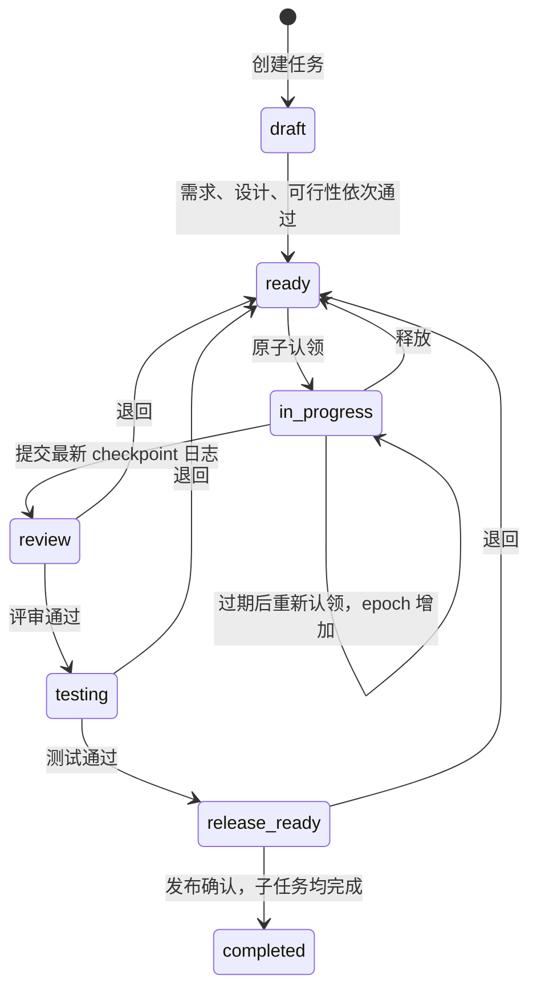

# 任务协作落地与复评

日期：2026-11-08，Asia/Shanghai。承接 [19 号全项目总审计](19_全项目总审计与实施路线.md)。本轮落实共同任务状态和工作日志，其他能力继续按原路线验收。

## 交付范围

服务端 **0.4.0 / 迁移 0007** 已发布到指定腾讯云服务器；Windows 桌面端 **0.6.1** 配套一体安装、任务 MCP 和任务查看。安装包正式发布与本机验收结果在本文最后记录。

| 能力 | 本轮结果 | 实际边界 |
| --- | --- | --- |
| 架构师拆解 | 有父子任务、需求、验收、仓库/目标端/相对路径声明 | 不是项目组与多仓库权限模型 |
| 人与 Agent 竞争认领 | 共用原子认领接口，一次一个主开发者 | 人工认领也不能绕过已有租约 |
| 多设备接手 | 10 分钟租约、心跳、递增 epoch | 旧运行过期后不能写新日志或提交 |
| 执行角色 | 开发、评审、测试、发布分别留下执行身份 | 不会自动启动或调度多个 Agent |
| 每轮工作日志 | 保存原文、变更路径、验证、阻塞、下一步和 SHA256 回执 | Skill 要求逐轮调用，尚无宿主自动钩子 |
| 日志共享 | `logs:read` 单独授权；否则只读本人原文 | 不能借项目读取权限读取所有同事原文 |
| 流程推进 | 需求、设计、可行性、开发、评审、测试、发布确认 | G4 的自动上下文与仓库权限证明尚未落地 |
| PC / Web | 读同一组任务、日志和流程决定 | 列表 5 秒轮询；动态通知用原有 2 秒轮询 SSE |
| Git 关联 | 日志可填提交 SHA，明确标记未核验 | 不会抓取提交、push、PR、CI 或部署结果 |
| 一体安装 | Windows EXE + 同发行 Skill + MCP 配置合并 | 首批 Codex / Claude Code / Cursor；不克隆业务仓库 |

## 状态与关口

所有变更通过现有设备签名认证、会话和项目授权校验，再按统一顺序取得用户及项目事务锁。并发认领、撤权、提交流程与角色决定不能靠客户端先读后写推测结果。另有部分唯一索引保证同任务不会存在两个活跃主开发运行。

每个开发执行者带 `task_id`、`run_id`、`lease_epoch`、实例 UUID、账号、设备与 harness 标识。角色字段不授予任何能力。默认约 2 分钟发送心跳；过期或 epoch 变化后重新核验任务。幂等重试返回原结果，不能将旧认领响应当成新续租。

租约保护同一个任务的主开发身份，不锁住其他任务里的同一路径。不同任务修改重叠文件时仍应使用独立 worktree / 分支并经过 Git 合并流程；本轮没有实现路径级排他锁或共享工程的进程隔离。

评审、测试、发布确认必须绑定当前 `submission_id`，并传最新任务版本。作者不能批准自己的评审或测试；超管单人项目只有明确填写至少 10 字符自审原因才允许例外，历史保留原因。不同对话或同一人切换角色名称都不能冒充独立审核。

退回后重新认领、提交和评审；旧测试通过不能沿用于新的代码轮次。尚有未完成子任务时父任务不能完成。进度通告的 `completed` 字段不会改变任务状态。平台发布确认也不会执行真实部署。

## 原文、回执与权限

新增 `tasks`、`task_runs`、`worklogs`、`task_decisions`。四表启用强制 RLS，任务及运行不可由普通 API 删除，日志和流程决定只向运行角色授予 SELECT/INSERT，不能覆盖或删除。跨项目父任务引用有数据库外键约束，接口另行校验。

工作日志字段有长度及 64 KiB 总量限制。相对改动路径必须属于声明的任务路径。日志回执绑定 ID、项目、任务、运行、作者、设备、epoch、时间及正文的规范化 SHA256。它证明服务器确认了哪份记录，不是代码内容的备份或外部时间戳。

`logs:read` 授权与代码评审、测试、任务发布分别授予。没有日志共享权时，读取接口只返回本人日志；不把项目管理员资格自动变成所有业务日志读取权。公共动态保存任务事件和记录 ID，不复制日志原文或关口依据。

当前专注范围是服务端日志申报与 Skill 行为约束，不构成本地 Shell 或文件系统隔离，也不产生 Git 仓库访问凭证。业务代码仍由各业务仓库真实授权。

## 验证与发布

- 指定服务器独立 `hub_test` 数据库：**84 项测试通过**，其中新增 13 项任务测试；测试入口继续硬性限制数据库名，未对正式库执行测试清空。
- 桌面端：**60 项 Node 测试通过**。包含 MCP 权限发现、固定项目路由、防止参数注入、续租与重试身份、版本冲突信息保留，以及既有签名更新和安装配置回归。
- Windows PowerShell **5.1** 安装检查通过：下载哈希、缓存、大小、跳转、正式下载地址、完整安装树、篡改和额外可执行资源。
- 实际 Electron、实际 stdio：登录/邮箱界面、三种配置输出、自定义 CODEX_HOME、管理创建、工程接入、文档与任务 MCP、PC 日志显示联调通过。API 使用隔离的 mock 传输。
- 实际 Chromium Web 界面：创建任务、三项准入、人工认领、填写日志、提交、评审、测试、发布确认点击链通过。界面 API 为隔离 mock；权限与事务以真实 PostgreSQL 测试为依据。
- Skill 结构校验通过。没有把 mock 界面联调当成两台物理设备或全部七种 harness 的生产验收。

正式发布前完成 PostgreSQL dump，并用 `pg_restore --list` 检查归档可读。部署后外部 HTTPS 健康检查返回 0.4.0、迁移 0007、四表强制 RLS。原有用户/设备/项目/设置数量保持不变；没有创建试验项目、导入 kms 或改变密码及 SMTP。

服务回退可切回旧应用镜像。0007 只新增结构，禁止用降级删除交接历史；数据库恢复是独立运维操作，不能当普通代码回退自动执行。

## 复评与下一阶段

协作主链从“进度通告”推进到“共同任务状态与原文日志”。仍不能将整个平台称为完整生产协作框架。以下缺口继续存在：

1. **可靠逐轮记录与交接**：宿主钩子、加密持久离线队列、代码快照、持久收尾回执。当前没有自动保存未提交文件。
2. **授权项目组组装**：独立仓库及日志资源授权、分支/路径投影、项目依赖、工作区组装、完整角色文档部署。
3. **分层记忆与向量**：服务器 pgvector 尚未安装；embedding/提炼模型、来源版本、增量知识卡片、授权检索、开工上下文加载回执尚未接入。不能以“表已创建”替代记忆验收。
4. **角色运行与 Git 证据**：项目经理/架构师/开发/审查/测试/运维的完整运行调度；提交、push、PR、CI、发布与回滚各自留真实事件。
5. **撤权收尾与卸载**：普通调用拦截已有；撤权后的限权上传、离线恢复和受管清单卸载仍未实现。断网或不合作设备不能保证远程删除。
6. **跨端与运维**：macOS 包、其他四种工具自动适配、两台物理设备协作验收；主机系统升级、异地备份与完整恢复演练。

建议下一轮优先实施第 1 项，再建立项目组资源授权和记忆流水线。任务日志原文先稳定保存，向量和摘要可以重建；不可先删除原文来节约 Token。

## Windows 制品及本机验收

本机已通过实际 NSIS 安装与完整安装树校验，一体安装助手已将同发行 Skill 和安装 MCP 合并到当前 `D:\agent_cache\codex`，原 Codex 配置已备份。实际 stdio 已识别安装连接工具，未登录状态返回 `LOGIN_REQUIRED`，没有代填密码或绕过邮箱验证。

实际旧缓存无法通过系统密钥解密，探测到的本地加密密钥记录也未能恢复它。原密文及原 Local State 已逐字节归档在原应用目录的 `credential-recovery-20261107T230040Z`，没有修改服务器账号、密码、SMTP 或会话。客户端需要重新登录。

该电脑原 Roaming 应用目录的同目录 Node rename 实测返回 `EXDEV`。没有去除目录的系统加密属性；新缓存使用 `D:\agent_cache\agent-hub`，仍通过 safeStorage 保护凭证。安装器增加写入探测、保留自定义目录的桌面/开始菜单参数，0.6.1 补丁同时将自定义目录带入开机启动参数。系统密钥语义参照 [Electron safeStorage 官方说明](https://www.electronjs.org/docs/latest/api/safe-storage)。

0.6.0 曾作为本轮首个制品发布，未覆写其不可变 URL；后续目录处理修复使用 0.6.1 和递增签名序号。EXE 未配置 Windows Authenticode 证书；在线更新文件使用项目已有 Ed25519 固定公钥校验。

最终正式 Windows 版本为 **0.6.1 / 签名序号 6**。EXE 与 ZIP 服务器端哈希已核对，正式下载地址返回 200，服务端 `check-desktop-feed` 验证签名及有效期通过。本机已安装 0.6.1，完整文件树校验与一体配置执行通过；重复执行未改写已有配置，真实全局 stdio 返回桌面版本 0.6.1。仅本轮执行后的当前用户安装得到验证，没有代替用户完成新设备登录。
