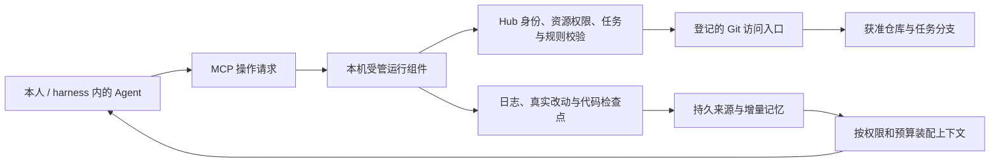

# 完整需求复核、GitHub 对照与 Token 预算

日期：2026-11-08（Asia/Shanghai）。对照完整历史需求、原 `install.md`、当前源码及正式服务器，补充 GitHub 上游核查。承接 [20 号整改复评](20_任务协作落地与复评.md)。

> 本文保留整改前服务端 0.4.0 / 桌面 0.6.1 的审计与 Token 基线。后续规则确认、摘要索引和本机检查点的实现与复评见 [22 号整改记录](22_规则执行与本机检查点整改.md)，不将本文历史缺口当作当前版本清单。

## 1. 结论与证据范围

**目前适合小规模验证任务协作，尚不能作为完整的多人、多项目组、跨端 Agent 协作与共享记忆平台验收。** 最大缺口是规则、实际代码改动、Git 交付、持久记录与记忆之间缺少连续证据链。增加提示词、向量库或安装更多 Skill 都不能单独补齐这条链。

这次区分三类结论：

- **已查实**：由当前源码、服务器只读查询或文本计数得出。
- **已测试但尚未业务验收**：上一轮 84 项后端、60 项桌面测试及隔离界面联调的范围。
- **拟实现**：本文的规则包、记忆治理、仓库桥接、消息总线和预算，不表示当前存在相应接口。

本次服务器只读实查：服务端 0.4.0、迁移 0007、Windows 发布 0.6.1 / 签名序号 6；PostgreSQL 18.6，只安装 plpgsql，`vector_available=false`，没有记忆/embedding/knowledge 表。正式任务和工作日志均为 0 条。由此不能推断已有真实多人持续协作、长期记忆或费用节省的验收结果。

当前桌面 MCP 版本检查通过，但本人登录状态为 `signed_out`。本次评估不依赖代替用户登录，也不创建业务项目、改变数据库结构或重发授权。

## 2. 全部需求映射

“部分”表示相关功能存在，但不能满足完整要求。优先级表示阻止完整目标交付的程度，不等同于已发现可利用漏洞。

| 需求 | 当前状态 | 缺少什么 / 应如何验收 |
| --- | --- | --- |
| 项目既能是一项工程，也能是一组独立项目 | 部分 | 当前主要是顶层 project 与任务；需工程、仓库、依赖、资源 ID 及组装清单 |
| 通用 Skill 在独立框架仓库，业务代码分别存仓库 | 基础成立 | 自动按授权组装和升级尚未建立，不能把创建平台项目说成业务工程已部署 |
| 成员只取得某个获准仓库 | 未闭环 | 平台权限与 GitHub/Git 凭证尚未联动；已获得的外部 Token 不受 Hub 自动撤销 |
| 仓库代码权与业务日志权分开 | 部分 | 有 project 级 `logs:read`；缺少项目组内按工程/业务资料范围授权及派生权限 |
| 超管创建项目/管理员，管理员申请授权由超管审批 | 基础已有 | 需补权限变更、紧急恢复、双端会话及真实多人验收；架构师角色名不能产生授权 |
| 管理员邮箱必填，成员可选，新设备按邮箱/超管规则验证 | 已有基础流程 | 继续保留原规则；故障恢复、账号回收和通知送达要验收 |
| 人与不同 Agent 原子认领同一个任务 | 已有后端测试 | 10 分钟租约、epoch；尚无自动宿主心跳及真实多设备验收 |
| 不同任务同时修改相同文件 | 未解决 | 同任务独占不覆盖跨任务重叠；需独立 worktree/分支、预约与集成检查 |
| 架构师拆任务、项目经理推进、开发/审查/测试/运维分工 | 部分 | 有执行身份和部分门控；缺少完整角色规范、能力注册、自动派工和依赖就绪任务 |
| Windows/macOS，七种 harness 跨端协作 | 部分 | Windows 首批三种配置合并；实际 stdio、Codex 识别已有；macOS 与其余四种完整适配未交付 |
| 每次开始先恢复必要规章、经验及同事交接 | 主要依靠 Skill | 没有版本化上下文准备包、自动注入、增量水位或准备回执 |
| 专注工程、目标端、功能，Web 不扩展 PC | 声明约束 | task.scope 有仓库/端/路径；缺少会话独立 focus、禁止功能、依赖/产物差异检查 |
| 禁止代码绝不能改 | 未形成执行限制 | 当前只校验申报路径，没有拦住本地编辑/终端；需只读挂载、文件权限或受控执行环境 |
| 原 P0/P1/P2 文档权限、删除前归档、越权报告 | 未完整迁移 | 缺少规则来源、批准动作、归档回执和确定性检查；普通用户同意不能扩大超管授予的权限 |
| 原 G1—G7、重试/超时及循环升级人工 | 部分 | 当前是固定顺序及文字依据，缺少风险级别、重试计数、超时告警、审批产物及真实提交绑定 |
| 每个改代码轮次都有笔记，包括失败、中断 | 接口已有，自动化未有 | 仍由 Agent 自行调用；不能确保一轮一条、真实改动齐全或中断保全 |
| 记录实时更新、实时共享 | 上报后的记录可共享 | 离线草稿和未上报改动不可见；须显示本地/待发/服务器已收/已提炼/已索引等状态 |
| 同事开发记忆共享并持续自净化/自进化 | 未实现 | 原文保全、来源版本、去重、冲突/失效、审核、增量提炼和权限检索未接入 |
| 年级别日志增长下控制 Token | 无产品内预算与计量 | 目前只是按任务分页，仍会返回整篇日志；需摘要索引、按 ID 展开、预算和成本观测 |
| 离职马上交接，恢复未提交工作 | 未实现完整恢复 | 日志回执不含代码；需检查点快照、基线 SHA、未跟踪文件、离线补传和干净机器恢复演练 |
| MCP 拉取/提交/推送仓库与 PR | 未实现 | 当前 MCP 没有 Git 交付工具，文档只读同步不能推送业务代码 |
| 多 Agent 异步对话、消息确认、跨端唤醒 | 未实现 | 目前共同任务库/PC 通知不提供 Agent 收件箱和执行接管；需运行适配与消息回执 |
| PC/Web 查看流程、提交、日志与通知 | 部分 | 任务及日志已共用；缺少完整提交/PR/CI/部署事件、记忆状态、预算及消息送达状态 |
| 撤权先上传、持久确认后卸载整个受管框架 | 普通操作拦截已有 | 限权收尾通道、部署归属清单、上传失败重试和卸载回执未实现 |
| 一句话安装、托盘、图标、通知和在线升级 | Windows 基础已交付 | 全组件版本一致、Skill 自动迁移、macOS 签名/公证、长期更新运维仍待验收 |
| 生产运维和长期服务 | 尚未生产验收 | CentOS 7 主机、容量、异地备份恢复、端到端告警、发信故障及轮换操作需收口 |

## 3. 为什么 Agent 经常不按原规章执行

从当前仓库看，原因有明确落点：

1. **规则没有稳定执行入口。** 绑定项目只写 MCP 配置，没有生成并核验原 install 的完整角色/规则入口。现有会话 Hook 只传版本检查结果，不加载项目规章或必要记忆。它不能证明每轮都遵守。
2. **原文包含规则、安装步骤、模板和历史，混在 1,576 行中。** 每轮全读成本高；只压缩又容易丢“禁止事项”。核心规则和可变经验应分别管理。
3. **原文与新系统存在语义冲突。** 全员共享 main.md 的“当前专注项目”、本地授权可绕过平台审批、完成才写日志等旧做法，不适合多人。保留全文供迁移不能等于让 Agent 原样执行。
4. **服务端核对的是 Agent 的声明。** `tasks.py` 仅检查 `changed_paths` 是否在 task.scope 内；没有对照 Git diff，也没有本地文件写入代理。漏报路径、绕过工具、修改后不提交都不会被当前路径检查发现。
5. **门控没有绑定实际代码版本。** 评审测试关联日志 ID，代码 SHA 是未核验引用。日志提交后再改工作区，当前服务仍不知道；“测试通过”文字不等于 CI 在对应 tree 上通过。
6. **多角色缺少真实运行边界。** 架构师/开发/审查并非改名字就有新身份、独立进程和最小资料范围；同一会话扮演多角色还会反复扩张上下文。
7. **没有偏差指标。** 未记录漏读规则、越界尝试、漏记轮次、重复开发、错误记忆及每项的成本，所以无法证明换模型后规章执行改善。

应把规则做成带稳定 ID、版本、适用资源、禁止动作和批准角色的规则包。原 install 可读 Markdown 保留，发布时产生机器可校验的数据和各宿主的短入口。同一规则的自然语言说明、确定性校验和验收案例必须对应，不能再产生相互矛盾的三份规章。

建议把执行检查放在：开始工作、写文件前、运行命令前、保存检查点、提交/push/PR/merge 六类节点。支持的宿主用 Hook 补强；不支持的只能提供降级能力说明。上下文回执证明交付/确认了哪一版材料，不证明模型真的理解；最终仍要看实际操作与验收。

## 4. “绝不能碰”的保证范围

| 层次 | 能做到的事 | 不能代替的事 |
| --- | --- | --- |
| Skill / 项目规则 | 告知禁止事项、要求扩大范围前重新授权 | 不能拦住任意本地终端 |
| 宿主 Hook / 受管写入组件 | 在其覆盖的工具调用前核验范围，记录拒绝 | 宿主可绕过、禁用时不能保证所有写入都经过它 |
| 文件权限 / 只读挂载 / 隔离工作区 | 在受控执行身份下阻止写受保护文件 | 与 Agent 同身份的本机管理员仍可能更改权限 |
| Hub Git 入口与远程规则 | 拒绝越界提交、陈旧任务代次和无证据合并 | 不能撤回已被修改的本地文件或已下载副本 |

普通协作可采取前三层加远程交付约束；若要求对本地任意命令也“绝对不能碰”，需把 Agent 放在不具有管理员权限的受控执行环境，并限制写入挂载范围。Windows 的普通只读文件标志不能等同于这样的访问控制。

只读仓库、禁止目录、必须额外审批的目录应分别登记；禁止项优先。路径判断处理规范化、大小写、链接/目录联接、仓库根、重命名、删除、LFS、submodule 及跨仓依赖。功能越界还需要检查依赖、构建产物和验收，不由路径正则单独解决。

远端分支保护可约束审查和状态检查，受账号方案、仓库可见性及管理员绕过配置影响；这与本地文件只读是不同保证。[GitHub 分支保护说明](https://docs.github.com/en/repositories/configuring-branches-and-merges-in-your-repository/managing-protected-branches/about-protected-branches)

## 5. Token 实测基线

计数使用 tiktoken 0.14.0，按 UTF-8 文本、CRLF 转 LF，分别计 `o200k_base` 和 `cl100k_base`。两种编码用于可重复的文本比较，**不是当前 Astra 或所有 harness 的账单 Token**。模型 tokenizer、实际工具序列化、缓存、对话历史、隐藏推理和厂商计费可能不同。[tiktoken 上游](https://github.com/openai/tiktoken)

原始计数和文件摘要保存在 [Token 基线 JSON](审计数据/2026-11-08_token基线.json)。只读取公开框架文本与工具定义，未统计凭证或完整用户聊天。

| 当前文本 | o200k_base | cl100k_base | 含义 |
| --- | ---: | ---: | --- |
| install.md 全文 | 19,121 | 23,555 | 每次全文注入会明显占上下文 |
| agent-hub SKILL.md 正文及元数据 | 1,191 | 1,504 | 当前短入口 |
| task-workflow.md | 951 | 1,170 | 任务协作按需参考 |
| work-records.md | 678 | 861 | 日志格式按需参考 |
| 19 号总审计全文 | 9,474 | 12,410 | 开发资料，不应作为每个工作会话默认上下文 |
| 项目连接全部 17 个工具定义 | 2,661 | 2,820 | 完整权限时的紧凑 JSON，非实际宿主协议开销 |
| 开发者常用 15 个工具定义 | 2,091 | 2,223 | 已依授权过滤，尚未按任务阶段进一步优化 |
| 只读项目连接 6 个工具定义 | 549 | 603 | 不含文档读取权 |
| 安装连接 5 个工具定义 | 600 | 656 | 只用于接入阶段 |

以 o200k_base 为例，Skill + 两份任务参考 + 全工具定义共 **5,481** Token，还没有业务需求、代码和历史；短 Skill 本身不能证明整套系统便宜。只读连接、最小工具集和按需参考能减少启动成本。

如果假设 20 次均重新加载全文 install，仅这份文本累计 382,420 / 471,100 Token。这个是假设的文本输入合计，实际模型可能复用缓存或根本没重新读；不能当作已发生费用。

### 当前会放大成本的具体位置

- `hub_list_worklogs` 默认 20 条并返回日志全文，没有“只查摘要索引—再按 ID 展开”的检索接口；长期按时间翻页既费 Token，也漏掉更早但相关的决定。
- 文档搜索是 `literal-substring`，按路径排序；全文读取没有行/章节预算，大文档会进入模型上下文。
- 正常续租要求执行者约 2 分钟发心跳。若每次由模型专门决策并调用，30 分钟任务约 15 次额外交互；应由持续运行的本机组件管理租约，模型只看异常。
- 代码快照、Git 上传、大测试输出如果被要求通过对话中的字符串反复传输，会额外生成、读取同一内容；可由本机组件直接读文件/执行确定性传输后返回短回执。
- 开发、审查、测试都接收整段聊天或所有历史会重复计费。交付清晰的任务与证据包，更适合角色独立执行。
- MCP 结构化结果和文本结果可能都包含同一 JSON。协议为兼容建议双表示，不能简单删字段；应分别检查各宿主实际交给模型的内容。[MCP Tool Result 规范](https://modelcontextprotocol.io/specification/2025-11-25/server/tools)

### 建议的首轮预算，均是目标

普通开发会话的协作上下文先试 **6,000—10,000 Token**，不含当前必要代码与实际任务输出。建议分配：必要规则 800—1,200，任务/焦点/权限 800—1,200，相关有效记忆 1,500—2,500，最新未提炼交接增量 800—1,500，工具定义及其他协议内容按剩余预算控制。必要红线不能为满足上限被静默裁掉；超出时缩小任务或显式升级预算。

每轮新增工作说明先试 150—500 Token；极简改动可少写，复杂决定允许超额。文件列表、时间、SHA、测试退出码和快照清单由组件自动采集，模型只解释目标、关键判断、问题和下一步。逐轮留证不等于每轮生成长篇作文。

后台提炼只处理新增/变更来源，按任务结束、积累阈值或空闲批次执行；不在每次检索前重新总结全部历史。向量化按内容哈希去重，版本变化才重算。稳定前缀有利于可用缓存，但缓存只是费用/延迟策略，不代替权限核验或准备回执。

**费用必须同时统计开发模型、审查测试模型、提炼输入/输出、embedding、可选重排、重试与失败。** 部分桌面订阅工具不提供完整 usage 时，应显示估算和缺测，不能假装是厂商账单。先比较同一批任务的全量读取、关键词检索、分层记忆、混合检索四种方案；同时衡量正确率、返工和交接成功率。

举例：1,000 条各 500 Token 的原文共 500,000，检索包限制为 8,000，在这个假设下只减少默认载入的文字约 98.4%；没有计算提炼费用与遗漏风险，不能据此承诺账单节省 98.4%。

## 6. 共享记忆怎样持续自净化

建议链路：**工具/改动事件 → 不可覆盖的来源原文 → 候选事实 → 去重、证据与冲突检查 → 有效记忆版本 → 按权限和任务装配上下文 → 本地只读缓存投影**。

| 资料层 | 更新策略 | 默认是否全量加载 |
| --- | --- | --- |
| 硬性规章 / 禁止事项 | 授权人员修改，留版本及变更审核 | 当前任务相关红线必须直接加载，不能依赖相似度召回 |
| 需求、架构、接口决定 | 带来源、适用工程、版本和生效范围 | 加载本任务相关有效版本 |
| 工作日志、错误输出、快照 | 原始记录保留；敏感内容限制采集 | 先索引/摘要，必要时展开 |
| 经验、错误预防、最佳实践 | 候选、验证、纠错、替代、失效的完整生命周期 | 检索相关有效经验 |
| 个人偏好 / 个人草稿 | 个人范围，不自动写入团队事实 | 按本人授权和任务需求 |

每条知识至少需要 `source_id/source_hash`、工程与资料范围、来源代码/文档版本、提出者、验证状态、有效起止、被哪个版本替代、生成器版本和 Token 成本。涉及硬性规则、接口契约和高影响决定的候选记忆需要相应审核。

自净化应完成：

1. 合并重复、近似事实，原始来源仍可追溯。
2. 新旧结论冲突时保留双方证据和争议状态；不能机械用最后一条覆盖。
3. 代码/依赖/接口版本改变时把相关旧结论标记待复验，降低默认召回权重。
4. 修复失败记录形成候选预防经验，验证成功后发布；不能把 Agent 自述完成直接当作事实。
5. 提炼作业保留水位；尚未处理的新日志作为最新交接增量加载，避免同事刚做的工作不可见。
6. 混合来源的摘要继承所有必要来源权限；权限变化使本地缓存和派生上下文失效，不能“总结后就公开”。
7. 同事日志中的指令按不可信资料处理，不能自动升级成项目规章，也不能扩大工具权限。

原文可以按保留策略移到冷存储；默认上下文只保留有效内容。自净化不能擅自删除唯一来源，也不能让提炼程序改写“不准动的代码”规则。依法/按业务政策要求删除是另一条有批准和派生数据清理的流程，不能与普通压缩混为一谈。

pgvector 适合继续使用服务器 PostgreSQL 做授权后的语义召回；同时保留路径、符号、错误码和关键词精确检索。它不提供自动纠错、蒸馏或自动注入。近似索引经过权限/资源过滤后可能不足量，应测试迭代扫描/分区，不能放宽权限来凑结果。[pgvector 检索与过滤](https://github.com/pgvector/pgvector#filtering)

当前数据库限额 512 MiB，不能直接承诺百万片段和多人规模。模型端点、embedding 维度、允许外发的数据、预算与密钥应放后台受控配置；先用少量中文业务/代码/交接问题测召回，随后再考虑更大索引或知识图谱。

## 7. 多人、跨设备、跨 harness 的协作边界

至少分清四个对象：人员账号、设备、harness 连接、实际角色执行实例。一人两台设备、同机两种 harness、同一 harness 两个开发角色都要分开；共享规则和任务，分别保存焦点、运行状态及本地缓存。

当前共同任务库解决了“谁认领同一任务”，尚未解决能力发现、派工、跨任务依赖、异步讨论、消息确认、活跃执行者探测和远程接管。PC 收到通知也不能保证远端 Agent 正在运行、看见并接受任务。

第一版可以在现有 Hub 加中央收件箱/发件箱、任务关联消息、去重键、持久游标和确认回执，由每台设备上真正可用的适配器接收；长任务租约由运行组件维持。宿主没有安全的自动启动入口时显示“待人工启动”，不能声称消息已唤醒 Agent。

对外需要连接其他独立 Agent 服务时再加 A2A 网关，映射相同 task/run/artifact ID，继续受 Hub 授权和流程约束。MCP 作为每个 harness 的工具入口；不要求全部宿主先实现 A2A，也不另造第二份任务状态。[A2A 与 MCP 的官方关系说明](https://a2a-protocol.org/latest/topics/a2a-and-mcp/)

每名开发者/任务使用独立 worktree 与分支，跨任务可做路径预约和冲突提醒。预约不保证本地写入安全，同仓分支不提供代码保密。新接手者应从明确基线和快照恢复，不能把另一台机器的未提交文件当作已经同步。

第一条真实验收链应为：两个人、两台设备、两种 harness、一个项目组和两个独立仓库；每个人只拿到获准代码，但按业务资料权限共享接口/交接；开发中途断网和撤权，另一端能从确认检查点继续。

## 8. MCP 怎样拉取和推送“这些仓”

这里将“推送这些仓”同时按两种含义评估：把获准仓库组装到本机，以及把开发改动推回仓库。**两条自动链当前都没有完成。** 现有 `hub_connect_project` 只绑定已存在目录及 MCP 配置；文档 Worker 下载 Markdown 索引是只读路径，不能替代 clone、commit、push 或 PR。

建议在现有 Hub 增加受管仓库桥接，不要求模型传一遍所有文件正文：

图中包含拟实现组件，不能把该图当作当前已运行的功能图。

1. 登记项目组与每个仓库的稳定 ID、真实远程、默认分支、保护规则、授权方式和共享资料范围。
2. MCP 发出结构化操作请求；桌面本机组件在已经登记的工程内执行确定性 Git 操作，通过服务端登记的仓库入口访问上游。
3. 拉取前检查代码读取权。创建任务专用工作区，不向缺少权限的成员组装其他工程。
4. 保存检查点时比较实际工作树和基线，检测删除/重命名/未跟踪文件、敏感文件及越界路径，生成可恢复快照。
5. commit/push/PR 分别核验任务 epoch、策略版本、实际 tree、目标远程和分支。基线不匹配时要求解决冲突，不默认强推。
6. 默认推送任务分支；合并和部署分别走已授权的审批与证据。禁止通过 alternate URL、直接 GitHub MCP 或全局凭证绕过受管上限。
7. Webhook/服务端查询确认远程 SHA、PR、CI 和部署事件，绑定日志与测试；短回执返回模型，大文件直接传输。

拟议工具可为 `hub_prepare_workspace`、`hub_git_status`、`hub_save_checkpoint`、`hub_commit_changes`、`hub_push_changes`、`hub_open_pull_request`。这些名称仅作设计，**当前不存在**。每个写操作都需稳定重试标识，凭证不出现在工具参数/返回/日志中。

GitHub 官方 MCP 提供 `push_files`、分支和 PR 工具，能作为快速试点的上游连接方式；`push_files` 要在参数中传文件内容，不等于把现有本地仓库原封不动执行 git push。本项目仍要加任务、资源权限和真实改动验证。[GitHub MCP 工具说明](https://github.com/github/github-mcp-server#tools)

长期建议服务端 GitHub App 按仓库和操作显式缩权，上游密钥与令牌留服务器；本机使用 Hub 的授权路径。GitHub App token 本身不提供路径级限制。若直接把一小时上游写令牌下发给客户端，它可在有效期内绕过 Hub，不能实现每次 push 即时撤权；应通过受管代理且远端关键分支同样设限。[GitHub App 安装令牌](https://docs.github.com/en/apps/creating-github-apps/authenticating-with-a-github-app/generating-an-installation-access-token-for-a-github-app)

业务仓库自己的个人/SSH 权限另行授撤。Hub 超管是平台身份，不自动等于 GitHub 仓库所有者。本人电脑用于维护框架的全局 GitHub 凭证不能分发给团队成员。

## 9. GitHub 上游逐项对照

本次阅读官方仓库、README/规范及相关源码位置；不是为本项目运行上游性能测试。公开默认分支提交指针见 [GitHub 参考版本 JSON](审计数据/2026-11-08_GitHub参考版本.json)。采用代码需锁定提交及许可证，不能依赖历史宣传或直接跟踪 main。

| 上游 | 本次确认的机制 | 对本项目的采用判断 |
| --- | --- | --- |
| [Superpowers](https://github.com/obra/superpowers) | 按技能组合的计划、独立工作区、开发与验证方法；也提供偏差诊断 | 借鉴短流程和角色工作方法；提示词中的“强制”不能取代代码权限，也不应每个小修改都自动展开多 Agent 流程 |
| [GitHub Spec Kit](https://github.com/github/spec-kit) | 结构化过程、模板和集成机制；项目 constitution 有变更治理与检查点 | 原 install 的固定规章可形成短规则与版本治理，接入确定性门控；不照抄上游项目本身的全部开发规则 |
| [OpenSpec](https://github.com/Fission-AI/OpenSpec) | 每个变更关联 proposal/spec/design/tasks，并适配不同工具 | 借鉴轻量变更材料；正式任务完成状态仍保存在 Hub，避免 Markdown 勾选与数据库两份真相 |
| [Beads](https://github.com/gastownhall/beads) | 有依赖就绪任务、原子认领、跨会话/跨仓协作；当前后端为 Dolt | 借鉴 ready/blocked、任务图与领取交互；继续使用现有 PostgreSQL，避免再引入 Dolt 维护第二套任务存储 |
| [MCP Agent Mail Rust](https://github.com/Dicklesworthstone/mcp_agent_mail_rust) | 收件箱、确认、线程、文件预约；README 明说单机/共享文件系统及 advisory 边界 | 消息与预约只能作为机制对照，不按即插即用分布式权限系统处理；当前 LICENSE 带特定主体限制，不建议直接复制为本项目依赖 |
| [Claude-Mem](https://github.com/thedotmack/claude-mem) | Hook 采集事件、生成观察、会话启动给精简索引，再按需取细节 | 很贴近自动记录与节省 Token 的方向；仍需补本项目的团队/业务权限和跨宿主适配；不照搬节省倍数 |
| [Mem0](https://github.com/mem0ai/mem0) | 当前文档说明 ADD-only 提取、多通道/时间信息检索；托管评测含开源 SDK 没有的优化 | 不能继续假设装上后会自动 UPDATE/DELETE 旧知识；“自净化”治理仍需自己明确实现，托管数字不能当本项目效果 |
| [A2A](https://github.com/a2aproject/A2A) | 独立 Agent 的发现、任务、消息和产物交互协议 | 有对外连接需求再加网关；协议不自动替用户启动七种开发工具，也不代替 Git 和资料授权 |
| [GitHub MCP Server](https://github.com/github/github-mcp-server) | GitHub 仓库/文件/PR 工具，支持工具集和只读配置 | 可用于 GitHub 连接，但对外提供本项目受控封装；只暴露必要工具，避免凭证过大和上下文膨胀 |
| [pgvector](https://github.com/pgvector/pgvector) | PostgreSQL 内向量查询、过滤及与关键词组合 | 适合服务器上的检索增强；没有自动记忆更新或权限治理的替代能力 |

上游的 README 支持列表与本项目的 Windows/macOS × harness 实测结果要分开。仅客户端接受 MCP 配置，不代表 Hook、自动加载、阻止操作、后台接收和角色执行都兼容。[Agent Skills 格式](https://agentskills.io/specification)规定按需加载结构，没有让 Skill 自动获得操作系统权限。

许可证备注：本次 API 返回 Superpowers/Spec Kit/OpenSpec/Beads/GitHub MCP 为 MIT，Claude-Mem/Mem0/A2A 为 Apache-2.0；pgvector 与 Agent Mail 的 SPDX 自动识别为 NOASSERTION，已经分别读取指定提交 LICENSE。pgvector 为 PostgreSQL 风格许可；Agent Mail 为带附加限制的文本，不能当普通 MIT。这里只记录文本差异，不对具体法律适用作结论。[Agent Mail 指定提交许可证](https://github.com/Dicklesworthstone/mcp_agent_mail_rust/blob/5afa2d79052878abf525b5259b13cb07ea84551a/LICENSE)、[pgvector 指定提交许可证](https://github.com/pgvector/pgvector/blob/724588a5504b0e9c462e3126563370e8d50a01eb/LICENSE)

## 10. 本次新增、需要优先解决的问题

| 优先级 | 代码事实 / 缺口 | 影响 |
| --- | --- | --- |
| P0 | 仅按上报路径检查，未比较实际工作树 | 越界修改可能不被发现 |
| P0 | 评审/测试绑定日志，未绑定不可变代码检查点 | 证据与实际交付可能错位 |
| P0 | 新日志要求有效租约及正常项目权限，断网/撤权/过期后没有收尾上传路径 | 有工作在本地也不能保证交接；不能为了补传恢复开发资格 |
| P0 | 规则与记忆没有准备包、版本回执和写入拦截 | “开始先读规章”只能依赖模型自觉 |
| P0 | 无资源级仓库授权与受管 Git 交付 | 多项目组容易把平台授权误当代码授权 |
| P1 | 无自动心跳，模型每 2 分钟调用 | 无谓消耗 Token，长工具执行时易丢租约 |
| P1 | 全文日志分页、文档全文读取，无 Token 上限/摘要定位 | 上线后上下文成本随资料增长，检索不精准 |
| P1 | 没有真实轮次 ID 和自动变更观测 | 很难证明每个改代码轮次都记过 |
| P1 | 更新会先拦受管调用并切换版本，无独立持久收尾协议 | 版本更新可能与日志上传、租约和未提交工作冲突 |
| P1 | 多人写操作经用户/项目事务锁串行协调，SSE 每个连接轮询数据库 | 正确性基础可用，吞吐/连接规模尚未压测，不能直接承诺大量并发 |
| P1 | 固定门控缺少原 2/5/7 级配置、超时、循环次数 | 小任务可能过重，大任务也缺少真实升级路径 |
| P1 | 安装成功、在线升级、Skill/模板规则版本不同步 | 旧入口可能继续指导已变化的 API |
| P1 | 没有真实业务任务/日志样本和两台物理设备验收 | 测试通过不能证明完整场景可用或省 Token |

## 11. 继续整改的顺序与验收

不需要推倒现有身份、任务和 PostgreSQL。沿用一套事实源，按下列依赖做小而完整的交付。

| 阶段 | 交付内容 | 验收结果 |
| --- | --- | --- |
| A 规则与原始事实 | 原 install 条款映射；角色/焦点独立；策略包、开始工作上下文；实际 diff 检测、逐轮事件、持久本地队列 | 规则未准备不得进入受管写入；越界路径/命令被拒；中断仍有检查点和待发状态 |
| B 仓库与可靠交接 | 项目组资源权限、Hub Git 桥接、独立工作区、代码快照、限权补传、远程 SHA/CI 证据 | 只拿获准仓库；MCP 能按规定拉取和推送任务分支；同事在干净目录恢复工作 |
| C 共享记忆与预算 | 原文/候选/有效知识、增量提炼、水位、权限、关键词+向量检索、上下文包、费用计量 | 新工作不用等提炼也能交接；旧错误不默认载入；红线不被压缩丢失；费用有实测 |
| D Agent 协作与跨端 | 中央消息/确认、执行能力注册、依赖派工、本端角色隔离；逐个宿主和 macOS 实测；可选 A2A 网关 | 两人两机两宿主跨仓完成需求、开发、评审、测试，消息/事件不丢且角色身份可追溯 |
| E 收尾与生产 | 撤权上传及归属清理、组件兼容更新、异地恢复、主机迁移/容量、告警和运维责任 | 无回执不删除唯一副本；旧资格不能复活；恢复、费用、容量和故障演练通过 |

阶段 A 中的待发保全需要先有窄权限收尾协议，阶段 B 完成完整代码快照/恢复；不能把“必须正常租约”当所有补传的前提，也不能为了离线工作允许无限期多端共同提交。

试点初始指标：

- 受控写入与 push 的越界验收用例全部被拒绝；未准备必要规则和权限时不执行受管变更。
- 在可观测宿主上，所有检测到代码变更的轮次有本地持久记录，并显示服务器确认状态；未覆盖的宿主明确降级。
- 同任务同时认领只有一个主执行者，陈旧 epoch 的常规提交全部拒绝；交接补传走单独通道。
- 新同事不用前任聊天记录，在清洁工作区恢复到确认检查点并完成预设任务。
- 建立至少 20—30 个代表性问题/任务，对比检索和提炼；红线用例不漏，来源与冲突可追溯。小样本通过后再扩大，不宣称统计上的零错误。
- Token、延迟、失败重试、提炼费用和返工一起报告；预算先作为观察/软限制，必要内容超额有明确处理，不能靠漏读压低费用。

**本次建议的产品取舍**：Skill 保留短入口与按角色加载的方法；Hub 保存授权、任务和共同状态；每端运行组件负责真实事件、守卫、快照和 Git；服务器记忆服务负责版本、增量与检索。MCP 连接工具，消息层连接执行者，Git 保存代码版本，原文与快照保证交接。分别建设，再用同一条真实任务验证贯通。

## 12. 本地代码核查入口

- [原规章及部署规范](../install.md)：角色、专注、门控、文档保护、自进化。
- [当前 Skill](../skills/agent-hub/SKILL.md)：实际工具流程及尚未实现能力说明。
- [tasks.py](../projects/agent-hub/src/agent_hub/tasks.py)：路径申报校验、租约、日志和门控。
- [models.py](../projects/agent-hub/src/agent_hub/models.py)：当前资源模型；尚无记忆及仓库操作实体。
- [documents.py](../projects/agent-hub/src/agent_hub/documents.py)：字符串匹配和全文读取。
- [setup-connection.cjs](../projects/agent-hub-desktop/core/setup-connection.cjs)：只绑定已有工程，不克隆仓库。
- [session-hook.cjs](../projects/agent-hub-desktop/core/session-hook.cjs)：会话入口目前只检查版本。
- [mcp.cjs](../projects/agent-hub-desktop/core/mcp.cjs) / [task-tools.cjs](../projects/agent-hub-desktop/core/task-tools.cjs)：当前工具清单没有 Git 推送、自动记忆或跨 Agent 消息工具。

本轮只读生产状态、研究上游、测量文本并保存评估资料，没有发布新程序，也没有改变正式权限、数据库和业务内容。
