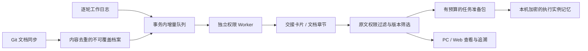

# 共享记忆、增量摘录与 pgvector

本批：服务端 0.9.0 / Alembic 0012，Windows 0.11.0。实施与验收记录见同目录 `审计数据/2026-11-09_共享记忆验收.json`。整体平台仍未完成七宿主、多实体设备及真实业务长期验收。

## 1. 这批解决什么

之前开工只取本任务最近 5 条日志摘要，文档同步会替换索引，缺少可以持续更新的共享记忆。这批建立来源留存、增量处理、版本淘汰、受权检索和本实例开工加载。

## 2. 保存与增量

| 数据 | 保存与寿命 |
|---|---|
| 日志原文 | 原有不可覆盖 `worklogs`；历史不因摘录淘汰而删除 |
| 文档档案 | `document_versions`，同源、配置、路径、原文件摘要去重；首次出现的 Git 提交与快照可追溯 |
| 原文件字节 | 新同步保存原字节及 SHA-256；历史迁入的解码文本标记 `exact_bytes=false` |
| 当前文档索引 | `project_documents.version_id` 指向不可覆盖档案；换版不销毁原文 |
| 增量队列 | 插入日志/档案的同一数据库事务触发，回滚不会产生孤立工作项 |
| 派生卡片 | `memory_cards`，幂等生成；工作交接保留原始验证与下一步，文档保留章节行号 |
| 生命周期决定 | `memory_events` 追加冲突/退役/恢复及原因，带版本防止覆盖决定 |
| 向量索引 | `memory_embeddings`，可重建；目前为空，不能替代原文档案 |
| 本机记忆 | 系统加密 Vault 内按账号、设备、仓库、run 隔离；不覆盖全局或业务 `AGENTS.md` |

Worker 使用 `FOR UPDATE SKIP LOCKED`，一项摘录及完成回执在短事务中提交。中断回滚；失败最多尝试 3 次，之后明确显示失败，有权人员可重试。没有周期调用模型，也没有把哈希冒充语义向量。

## 3. 权限继承

派生卡片、队列状态、来源原文和向量行均通过 PostgreSQL RLS 查询原始来源权限。同事日志须有 `logs:read`；文档与代码的仓库授权分别生效。固定仓库 MCP 禁止切换到另一仓库。

文档配置变化立即阻断旧配置档案；仓库、成员、设备与账号授权变化实时阻断派生查询，无须等待 Worker 清理。准备回执也按当前来源重新验证，幂等缓存不能重新导出已经失去权限的准备包。旧准备包只供本作者、本设备读取，且仍须满足来源权限。

API 只有派生数据读取和生命周期决定权限，不能改写档案或卡片。摘录 Worker 仅使用独立 `hub_memory_worker`/`hub_memory` 角色，没有发信配置、仓库凭证或代码制品写权限。

## 4. 版本与自净

- 同任务较新的交接替代旧交接；不同任务的历史仍可按关键词检索。
- 文档换版、删除后旧章节退出默认结果，档案及历史卡片保留。
- 冲突、退役卡片退出默认结果；恢复不能把已经被来源替代的内容重新变成当前事实。
- 已载入文档被替换，或卡片被标记冲突/退役时，修改检查与后续受管提交要求重新准备确认。
- 新日志不会静默改写当前已确认准备包；新会话/重新准备会纳入新历史。

这是确定性的版本自净和人工冲突处理。尚未实现自动识别语义矛盾、模型事实蒸馏及跨模块长期语义归纳。

## 5. 预算与使用

`hub_prepare_work` 自动返回 `payload.memory`；读取卡片、`coverage` 与 `gaps`，再确认全部规则和完整哈希。代码修改前 `hub_check_changes` 校验本轮规则、范围、租约与已载入来源的有效性。

记忆部分默认最多 **12,000 UTF-8 字节**，限制序列化内容；它不是某个模型的计费 Token 数。候选上限、截短、队列未完成、失败和无匹配均明确报告。当前任务尚未提取的新日志会单独补入准备包。

按需使用 `hub_get_memory_status`、`hub_search_memory`、`hub_read_memory_source`。很长的单行原文使用返回的行号与字符游标继续读取；每次最多 16,000 正文字节。已确认的本实例记忆可经 `hub_load_memory` 加载，须联网重新核验权限。

PC 和 Web 新增“共享记忆”入口。每 5 秒查询处理状态，不调用模型；原文仅点击展开。Web 可记载生命周期决定、重试失败提取。退出账号、权限变化或来源校验失败会丢弃本机派生记忆，原有工作检查点与撤权交接基线继续保留。

[本批文本测量](审计数据/2026-11-09_0110_Token测量.json)使用公开的 `o200k_base` / `cl100k_base`：Skill 主文约 1,862 / 2,358 Token，仓库开发者可见的 33 个工具描述约 4,439 / 4,802 Token，一份隔离测试记忆包为 844 / 874 Token。引用文档、工具调用结果和会话历史仍会额外消耗上下文；这些数字不是 Astra 的账单或真实业务节省率。当前没有一年以上历史规模的召回与成本实测。

## 6. pgvector 与部署

数据库只在 `47.109.23.86`，不在开发电脑安装 PostgreSQL 或 Docker。保留 PostgreSQL 18.6 与原数据卷，用候选构建并验收后的扩展镜像替换。

- 基础镜像：`postgres:18.6-bookworm@sha256:f1ea2a1a4fb7b68d4836be1fdcb8a6466a89b072158bf9d97663600538c294c5`。
- pgvector：`v0.8.7`，提交 `f37c13f68b57d2c3472b2214fbcff699d6d34876`。
- 源码包 SHA-256：`83d673c3b287cddbf3879f86215f043f2c2b56c69d37b2a77504910db1ed6e56`。
- Dockerfile：`projects/agent-hub/deploy/Dockerfile.postgres-vector`；独立构建阶段，运行镜像只复制扩展和许可证。
- 数据库安装扩展由运维超级角色执行，迁移与运行角色没有安装扩展权限。
- 未建立近似向量索引，也未配置 Embedding 供应方。后续语义检索需要显式选择模型、数据发送范围、版本与评测集；不能仅因表可写就宣称已具备语义记忆。

[pgvector 上游源码](https://github.com/pgvector/pgvector/tree/f37c13f68b57d2c3472b2214fbcff699d6d34876)支持 PostgreSQL 13+、精确检索和多种距离函数。本批只验收扩展安装、向量往返与 RLS 隔离；生产没有生成语义向量。

## 7. 验收与边界

本批门禁覆盖：真实服务器 PG 测试、桌面测试、Windows Controller 到真实 HTTP/DPoP/PG/Worker 的交接闭环、PC/Web 界面、非空档案恢复、正式迁移前备份、迁移后加密备份恢复、安装包与在线升级、凭证扫描。

后端真实 PG 测试 **156 项**、桌面测试 **106 项**通过。实际联调使用一台实体 Windows 上的三个逻辑设备，覆盖同事交接、增量可见、仓库隔离、冲突失效及撤权拒绝；PC/Web 记忆界面另用模拟后端验证，不能合称多台实体设备的正式业务验收。

正式切换时网关曾缓存旧 API 容器地址，公网检查触发回退；补齐 Nginx 重载后重发成功。迁移和原数据保留。正式库仍无项目及业务原文，正式恢复验证不构成非空业务验收；另有隔离测试的非空恢复证据。带测试标记的临时容器、网络与匿名测试卷已清理，正式数据卷继续保留。

验收结果、制品摘要与安装状态以审计 JSON 为准。测试身份、测试文档及逻辑设备不等于已接入真实业务，也不等于多台实体设备验收。

仍需推进：Embedding 配置与召回评估、长期语义提炼与冲突判断、完整角色文档迁移与跨宿主调度、其他宿主和 macOS 实测、kms 真实业务试点、持续异地备份及外部告警。没有操作系统级文件写入沙箱；Agent 绕过 MCP 直接运行 Shell 的行为不受文档回执约束。
