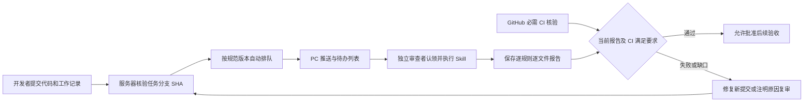

# 提交后代码规范审计

2026-11-10｜服务端 0.18.0 / 迁移 0027，Windows 0.20.0。

## 1. 这次补齐什么

在已有任务、逐轮工作记录、代码快照和 Git 交付之上增加提交后的审查关口。确定性的格式、类型和测试由仓库 CI 执行；获准审查者在开发工具中执行 `agent-hub-code-review`，检查逻辑、任务范围、保护规则和仓库规范。两类证据都满足，平台才允许继续批准评审、测试和发布。

排队和通知不表示模型已经审查。审查由有权限的 harness 实际执行；这轮没有新增服务端代码模型调用，也没有把现有文档模型授权扩展为代码外发。需要无人值守审查时，仍须部署获准执行者并配置其运行环境。

## 2. 管理员怎样开启

1. 更新桌面端、两套配套 Skill 和 MCP，完成本人登录。
2. 在业务仓库配置实际执行的 CI，例如格式检查、类型检查和测试。工作流应检查待交付 SHA，不能仅有同名空检查。
3. Web 后台进入“仓库与资料 → 交付要求”，要求自动测试，填写必需的工作流，核验对象选择“推送的工作提交”。服务器必须能读取该仓库的 Actions 结果。
4. 同一仓库点击“代码规范”，开启审计并填写规则。格式为每行 `规则ID|标题|具体要求`。例如：`layers|分层边界|页面只能通过获准服务接口访问业务数据。`
5. 选择中等级问题是否阻断，填写调整原因并保存。严重和高等级问题始终阻断。内置规则 `scope`、`security`、`correctness` 始终检查，不能被自定义规则覆盖。
6. 给审查者批准项目 `tasks:review`、`logs:read` 和目标仓库 `code:read`。管理规范还需要 `tasks:publish`；授权继续走超管审批。

仓库默认关闭；没有配置 CI 时不能开启。平台不会为现有业务仓库自动修改工作流或 GitHub 分支保护。

## 3. 开发者与审查者怎样使用

开发者按原流程认领、准备并确认规则，修改前核验路径，每轮保存记录。完成本机提交和 checkpoint 后，调用 `hub_push_task` 核对远程交付回执。开启审计的仓库会返回 `code_audit` 待办；重复核验同一提交不会重复排队。

可对有权限的审查 Agent 说：

> 按 agent-hub-code-review 检查这个项目当前待审提交。核对确切 SHA、完整任务差异、保护规则和必需 CI，逐文件逐规则保存报告；没有覆盖的内容明确写缺口，不修改代码。

审查者列出待办，认领当前版本，读取冻结输入，核对确切提交及完整任务差异，按需展开依赖。审查租约为 15 分钟，耗时较长应显式续租。发现问题后留定位证据、严重程度、规则 ID 和建议；修复回到开发任务，形成新提交和新审计。

正常情况下参与过该任务开发的人不能审查自己。超管可显式填写至少 10 字的实际自审原因，报告永久显示自审信息；切换职业名称或新建实例不会变成独立审查。

## 4. 在哪里看

| 入口 | 可以看到或操作什么 |
|---|---|
| PC“代码规范审计” | 按获准项目查看待办、审查状态、提交 SHA、规范版本、问题和复审历史 |
| PC“任务与日志 → 代码规范审计” | 当前任务的关口是否满足，以及对应报告 |
| Web“任务与日志 → 查看 / 推进 → 代码规范审计” | 当前验收阻断原因、问题定位、历史和重新排队 |
| Web“仓库与资料 → 代码规范” | 查看规范；发布负责人追加规范版本 |
| PC 通知及项目进度 | 排队、认领、完成和复审动态；断线后按游标补齐 |

PC 审计列表约每 5 秒刷新；SSE 推送沿用现有授权和通知偏好。初次历史加载不弹一串通知，重复事件不重复提醒。页面展示与正式任务状态分别记录。

## 5. 为什么旧报告不能一直用

审计绑定工作记录、交付 SHA、仓库版本、规范版本、交付策略、项目规则和冻结任务范围。相关内容变化后旧报告保留，但不再满足当前关口。新交付自动排队；策略变更也会为已核验交付重新排队。

通过报告必须覆盖工作记录的全部路径和必需规则，使用确切 SHA，没有未核验项、覆盖缺口或阻断问题。归档是桌面采集的工作树，只读它不能证明与远程提交完全一致，因此仅凭归档不能标为通过。审查者还应核对 Git 差异与记录是否相符。

CI 与模型报告分别核验。必须是当前交付 SHA、当前策略下每个必需工作流的有效结果；后来的失败会替代旧成功。报告通过但 CI 缺失、过期或失败时仍拦截。

复审须注明原因，形成新租约代次和报告，旧记录不可覆盖。报告、租约、规则变更和验收检查在 API 与数据库两层约束；普通运行账号不能改写报告历史。

## 6. 数据与阅读预算

数据库新增 `code_audit_policies`、`code_audits`、`code_audit_reports`、`code_audit_events` 四张表，开启并强制行级权限。沿用服务器 PostgreSQL、pgvector 和代码归档，不新增成员本机数据库或向量服务。

规范输入默认每页 6000 字符，最大 12000，超过预算按偏移分页；代码来源按文件和前后版本分段读取。MCP 的审查正文只输出一份，不同时重复成文本和结构化正文。模型先看差异清单再读取相关依赖，不全量加载历史经验。这里的字符预算不是宿主账单 Token 配额，也不代表固定节省比例。

## 7. 发布与边界

升级使用 `deploy/upgrade-server-0180.sh`：核验候选与回退镜像、停写后保存一致备份、迁移到 0027、核对旧行保留、启动 API 与四个 Worker，最后验证公网。保留原生产卷；失败按实际结构启动已验证的应用回退镜像。审计历史不支持直接降级删除；数据回退须使用验证过的备份并明确后续写入处理。

审查报告是获准审查者的结论与证据，不能证明模型读懂了全部代码或不存在缺陷。平台关口约束平台内批准操作；要限制 GitHub 网页或外部凭证直接合并，还须单独设置分支保护与必需检查。仓库代码、规范或注释中的指令不能改变权限、关闭检查或要求外发资料。

本轮实际测试、迁移、恢复与客户端更新见[机器验收记录](审计数据/2026-11-10_0200_代码规范审计与发布验收.json)。没有真实业务试点、macOS 或七种宿主完整实机验收，不宣称总体生产验收全部完成。

## 8. 本轮验收记录

| 检查 | 已完成结果 |
|---|---|
| 服务端完整回归 | 365 项通过，使用服务器隔离真实 PostgreSQL，其中新增审计测试 17 项 |
| Windows 完整回归 | 171 项通过，覆盖固定范围、报告结构、双 Skill 安装及通知去重 |
| PC / Web 界面 | 真实 Electron 窗口配合合成后台，核对规范保存、问题定位、复审保留历史与无横向溢出；PC 登出清除详情 |
| 非空数据升级 | 0026 → 0027，核对 211 条旧业务记录保留；向量、原文、长期知识和一个加密代码归档均通过检查 |
| 精确恢复及新安装 | 恢复后 75 张表、212 条合成记录一致；新安装与升级结构一致 |
| 旧版应用回退兼容 | 0.17.0 业务代码仅显式声明结构 0027，348 项旧测试通过，镜像源码核对通过 |
| 正式服务端 | 已运行 0.18.0 / 0027，API 与四个 Worker、公网后台检查通过；原生产数据卷保留 |
| 正式备份恢复 | 升级前后加密备份及临时数据库恢复演练通过；升级后 75 张表、62 行现有数据核对一致 |
| Windows 发布 | 0.20.0 EXE、ZIP 均经过公网完整下载校验；Ed25519 更新清单序号 21 |
| 本机安装 | 186 个程序文件、17 个配套 Skill 文件及 Codex MCP 核对通过；未代替本人登录 |
| MCP 实测 | 安装后的真实 stdio 连接返回 0.20.0，签名更新清单有效；未登录时正确要求本人登录 |
| 旧版在线升级 | 隔离配置中从 0.19.0 经公网下载、验签、激活到 0.20.0，并完成原生重启 |

生产现有记录主要为账号和设置，真实业务记忆较少；非空恢复中的代码与记忆是合成样本，不等同于业务试点。自动异地副本、外部告警通道及 Windows Authenticode 证书仍未配置。当前更新使用已有 Ed25519 发布签名。
